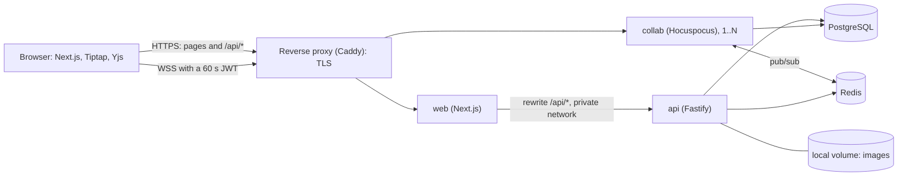

# CoNote – Real-Time Collaborative Workspace

> **Project status (2026-11-26): Phases 1–10 are implemented and owner-verified locally; Phase 11 (production deployment) is prepared and rehearsed but the application is NOT deployed anywhere.** All planned product features are implemented. A production configuration, a deployment runbook and an automated production-verification script exist and were exercised on a production-topology stack on one machine (HTTPS, a separate `wss://` collaboration origin, `__Host-` cookies); no public server, domain or hosting account was available, so **no real deployment has been verified**. Nothing in this repository claims that a live instance exists. Details, the exact evidence and the remaining owner steps: [`docs/DEPLOYMENT.md`](docs/DEPLOYMENT.md) §16 and §18, and [`docs/HANDOVER.md`](docs/HANDOVER.md) §16.

CoNote is a collaborative workspace inspired by Notion and Figma. Multiple people can edit the same rich-text page at the same time, see each other's cursors and presence, discuss content in comment threads, and browse or restore earlier versions, without losing concurrent changes.

## Features

| Area | Capabilities | Status |
|---|---|---|
| Authentication | Registration and login, secure server-side sessions (`__Host-` cookie, Argon2id), session list and revocation, user profiles, protected routes | Implemented (Phase 2) |
| Workspaces | Create and manage workspaces, invite members by link, roles (Owner, Admin, Editor, Commenter, Viewer), transfer of ownership | Implemented (Phase 3) |
| Pages | Nested pages, move, soft delete and restore, per-page permission overrides, activity log | Implemented (Phase 3) |
| Rich-text editor | Headings, paragraphs, bold/italic/underline, lists, checklists, links, images, tables, alignment, slash commands, toolbar, keyboard operation | Implemented (Phase 4); images are stored on local disk |
| Real-time collaboration | Yjs CRDT, simultaneous editing, reconnection and recovery, read-only roles, access revocation, multiple sessions | Implemented (Phases 5–6) |
| Presence | Avatars, coloured cursors with names, selection highlighting, online list, join/leave notices; never stored | Implemented (Phase 7) |
| Comments | Anchored comment threads, replies, resolve/reopen, delete, live highlights, detached threads keep their quoted text | Implemented (Phase 8); no editing of comments, no notifications |
| Version history | Manual and automatic snapshots, read-only view of a version, restore as a new change with a "Before a restore" snapshot | Implemented (Phase 8) |
| Scalability | Several collaboration-server instances synchronised through Redis, explicit recovery after Redis outages | Implemented (Phase 9); one instance in the reference deployment |
| Security and testing | Rate limits, abuse protection, security headers and CSP, 1,150+ automated tests, 13 browser tests | Done (Phase 10) |
| Production deployment | Production Compose stack, Caddy TLS proxy, backup and restore-drill scripts, black-box verification script | **Prepared, rehearsed locally, not deployed (Phase 11)** |

Not planned for the first version: offline-first editing, external guest access, public page sharing, e-mail verification and password reset, e-mail delivery of invitations. See [`docs/PROJECT_MASTER.md`](docs/PROJECT_MASTER.md) for the scope and [`docs/HANDOVER.md`](docs/HANDOVER.md) §16 for the known limitations.

## Technology stack

| Layer | Technology |
|---|---|
| Frontend | Next.js (App Router), React, TypeScript, Tailwind CSS |
| Editor | Tiptap / ProseMirror |
| Collaboration | Yjs (CRDT), Hocuspocus WebSocket server, Redis |
| API | Node.js 24, Fastify, Zod |
| Data | PostgreSQL 17, Prisma ORM |
| Image storage | Local disk (a persistent volume); an S3-compatible adapter is not implemented (`docs/DECISIONS.md` D55, U7) |
| Tooling | pnpm workspaces, Docker, Vitest, Playwright, GitHub Actions |
| Production reference | One server: Docker Compose + Caddy (automatic TLS), proposed in D71 |

Exact pinned versions are in `docs/PROJECT_MASTER.md` §6 and the lockfile.

## Architecture



- The browser reaches the API **only through the web origin** (Next.js rewrite, D6), so the session cookie is host-only and REST needs no CORS. The collaboration server is a separate public origin, authenticated by a short-lived token from the API and an `Origin` check.
- **PostgreSQL is the durable source of truth**, including collaborative documents. **Redis is coordination only** and never permanent storage.
- Documents are persisted as incremental Yjs updates, compacted periodically, with immutable snapshots for version history. A restore is serialised against concurrent editing by a durable barrier in PostgreSQL.
- The project does not claim zero data loss: guarantees G1–G7 are defined in [`docs/ARCHITECTURE.md`](docs/ARCHITECTURE.md) §8 and are tested; anything outside them is not promised.

## Repository layout

```text
conote/
├── apps/
│   ├── web/        # Next.js frontend
│   ├── api/        # REST API and application services
│   └── collab/     # Hocuspocus collaboration server (+ scripts/verify-deployment.ts)
├── packages/
│   ├── db/         # Prisma schema, migrations, document and snapshot stores
│   ├── shared/     # Zod schemas, env validation, permission logic, protocol definitions
│   └── editor/     # Tiptap extensions, Yjs binding, presence carets, comment anchors
├── e2e/            # Playwright browser tests
├── docs/           # Architecture, operations and planning documents
├── infra/          # Dockerfiles, development Compose, production Compose and Caddyfile
├── scripts/        # Setup, key generation, backup and restore-drill scripts
├── tests/          # Cross-cutting tests (module boundaries, process startup)
├── .github/        # CI workflow
└── CLAUDE.md       # Permanent instructions for AI-assisted development
```

## Installation and development

Prerequisites: Node.js 24 (`.nvmrc`; the install refuses other majors), pnpm 12.18.0 (`corepack enable`), Docker with Compose v2.

```bash
pnpm bootstrap        # creates .env, installs, starts PostgreSQL + Redis, builds packages, runs migrations
pnpm dev:api          # http://localhost:4000   (/health, /ready)
pnpm dev:collab       # http://localhost:4100   (/health, /ready)
pnpm dev:web          # http://localhost:3000   (/health)
```

Run all three apps: the editor connects to the collaboration server, so a page cannot be edited without `pnpm dev:collab`. Open http://localhost:3000, register, create a workspace and a page.

Manual equivalent: `cp .env.example .env`, `pnpm install`, `pnpm infra:up`, `pnpm build:packages`, `pnpm db:migrate:deploy` (the db scripts read the repository-root `.env`). The collaboration token keys are generated with `node scripts/generate-collab-keys.mjs --write`.

Configuration: every variable, its default and its production rule is in [`docs/DEPLOYMENT.md`](docs/DEPLOYMENT.md) §4; `.env.example` holds development placeholders only. **Never commit `.env` or any `.env.*` file** (only the two `*.example` files are tracked).

Quality checks: `pnpm lint`, `pnpm format:check`, `pnpm typecheck`, `pnpm test:unit`, `pnpm test:integration` (needs `pnpm infra:up` + migrations), `pnpm test:e2e` (needs the three apps running and a Chromium), `pnpm build`. The full test run takes several minutes; `pnpm test --testTimeout=30000` is the form used for verification. See [`docs/TESTING.md`](docs/TESTING.md).

## Production deployment

The reference production target is **one server running `infra/docker-compose.prod.yml`** behind Caddy (automatic HTTPS), described and costed in [`docs/DEPLOYMENT.md`](docs/DEPLOYMENT.md) §13 and §17. In short:

```bash
cp .env.production.example .env.production     # fill every value on the server; never commit it
C="docker compose --env-file .env.production -f infra/docker-compose.prod.yml"
$C build && $C run --rm migrate && $C up -d
VERIFY_APP_URL=https://app.example.com pnpm verify:deployment   # 24 black-box checks
```

Requirements and costs, stated plainly: the application needs a host with persistent WebSockets, a persistent disk and PostgreSQL; **no free tier was found that meets that** (free instances sleep, lose files or expire databases); the cheapest honest option is a small paid server (roughly €5–8 a month) plus a domain. Production refuses plain `http://`/`ws://` public URLs. Backups are a script, not a schedule: set one up (`scripts/backup-postgres.sh`, `scripts/restore-drill.sh`).

## Roadmap

| Phase | Name | Status |
|---|---|---|
| 0 | Documentation and Architecture | Done |
| 1 | Project Setup and Infrastructure | Done (collaboration spike S1–S11 passed) |
| 2 | Authentication and User Management | Done, owner-verified locally |
| 3 | Workspaces, Pages and Permissions | Done, owner-verified locally |
| 4 | Rich-Text Editor | Done, owner-verified locally |
| 5 | Yjs CRDT Integration | Done, owner-verified locally |
| 6 | WebSocket Server and Real-Time Collaboration | Done, owner-verified locally |
| 7 | Presence and Collaborative UI | Done, owner-verified locally |
| 8 | Comments and Version History | Done, owner-verified locally |
| 9 | Redis Scaling and Performance | Done, owner-verified locally |
| 10 | Testing, Security and Optimization | Done, owner-verified locally |
| 11 | Deployment and Final Documentation | **Documentation, packaging and local rehearsal done; not deployed** (blockers in `docs/DEPLOYMENT.md` §18) |

Final owner acceptance of each phase and the checks still open (GitHub Actions on the latest phases, the Docker images, a real deployment) are tracked in [`docs/HANDOVER.md`](docs/HANDOVER.md).

## Documentation

| Document | Contents |
|---|---|
| [`docs/PROJECT_MASTER.md`](docs/PROJECT_MASTER.md) | Overview, requirements, permissions, technology stack |
| [`docs/ARCHITECTURE.md`](docs/ARCHITECTURE.md) | Components, flows, persistence guarantees, diagrams (including the production deployment view, §26) |
| [`docs/DATABASE_SCHEMA.md`](docs/DATABASE_SCHEMA.md) | Prisma/PostgreSQL design (15 tables) |
| [`docs/API_CONTRACTS.md`](docs/API_CONTRACTS.md) | REST API contracts (53 endpoints) |
| [`docs/WEBSOCKET_PROTOCOL.md`](docs/WEBSOCKET_PROTOCOL.md) | Collaboration protocol, presence and application messages |
| [`docs/DECISIONS.md`](docs/DECISIONS.md) | Numbered decisions and unresolved questions |
| [`docs/IMPLEMENTATION_PLAN.md`](docs/IMPLEMENTATION_PLAN.md) | Phase-by-phase roadmap |
| [`docs/TESTING.md`](docs/TESTING.md) | Test strategy, results and the Phase 11 testing report (§8.0k) |
| [`docs/PERFORMANCE.md`](docs/PERFORMANCE.md) | Benchmarks (single shared vCPU; not capacity figures) |
| [`docs/DEPLOYMENT.md`](docs/DEPLOYMENT.md) | Production infrastructure, configuration, runbooks, verification, costs |
| [`docs/DEMO.md`](docs/DEMO.md) | How to prepare and record a demonstration |
| [`docs/HANDOVER.md`](docs/HANDOVER.md) | Current status, known limitations, future improvements |

## Working method

Development proceeded one phase at a time with owner approval between phases. Architectural decisions are recorded with permanent IDs in `docs/DECISIONS.md`, and unresolved questions are listed rather than assumed. See `CLAUDE.md` for the rules that govern AI-assisted work on this repository.

## License

Not yet chosen (see `docs/DECISIONS.md` U12).