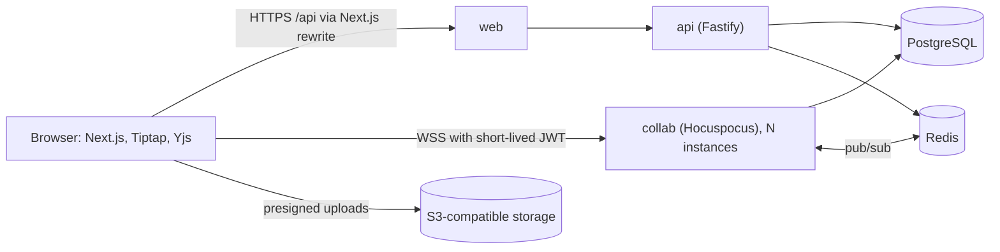

# CoNote – Real-Time Collaborative Workspace

> **Project status: planning (Phase 0).** The architecture and documentation are complete for review; **no application code has been written and no feature below is implemented yet.** Everything described here is the *planned* design.

CoNote is a collaborative workspace inspired by Notion and Figma. Multiple people will be able to edit the same rich-text page at the same time, see each other's cursors and presence, discuss content in comment threads, and browse or restore earlier versions, without losing concurrent changes.

## Planned features

| Area | Planned capabilities |
|---|---|
| Authentication | Registration and login, secure server-side sessions, user profiles, protected routes |
| Workspaces | Create and manage workspaces, invite members by link, roles (Owner, Admin, Editor, Commenter, Viewer) |
| Pages | Nested pages, soft delete and restore, per-page permission overrides, autosave |
| Rich-text editor | Headings, paragraphs, bold/italic/underline, lists, checklists, links, images, tables, slash commands, extensible architecture |
| Real-time collaboration | Yjs CRDT, simultaneous editing, reconnection and recovery, multiple sessions |
| Presence | Avatars, colored cursors with names, selection highlighting, online list, join/leave notifications |
| Comments | Anchored comment threads, replies, resolve/reopen |
| Version history | Snapshots, view previous versions, restore as a new change |
| Scalability | Multiple collaboration-server instances using Redis; persistent Yjs storage in PostgreSQL; recovery after restarts |

Not planned for the first version: offline-first editing, external guest access, public page sharing, email verification/password reset. See `docs/PROJECT_MASTER.md` for the full scope.

## Technology stack (planned)

| Layer | Technology |
|---|---|
| Frontend | Next.js (App Router), React, TypeScript, Tailwind CSS |
| Editor | Tiptap / ProseMirror |
| Collaboration | Yjs (CRDT), Hocuspocus WebSocket server, Redis |
| API | Node.js, Fastify, Zod |
| Data | PostgreSQL, Prisma ORM |
| Object storage | S3-compatible storage (MinIO for local development) |
| Tooling | pnpm workspaces, Docker, Vitest, Playwright |

Exact pinned versions and the compatibility checks behind them are listed in `docs/PROJECT_MASTER.md` §6 (verified against package metadata on 2026-11-11; not yet installed or run together).

## Planned architecture



- **PostgreSQL is the durable source of truth**, including collaborative document recovery. **Redis is coordination only** and never permanent storage.
- Documents are persisted as incremental Yjs updates, compacted periodically, with immutable snapshots for version history.
- The project does not claim zero data loss or automatic reconvergence after Redis outages: persistence and recovery guarantees are explicitly defined and will be stated as verified only when their tests pass (`docs/ARCHITECTURE.md` §8).

## Repository layout (planned)

```text
conote/
├── apps/
│   ├── web/        # Next.js frontend
│   ├── api/        # REST API and application services
│   └── collab/     # Hocuspocus collaboration server
├── packages/
│   ├── db/         # Prisma schema, migrations, document store
│   ├── shared/     # Zod schemas, types, permission logic
│   └── editor/     # Tiptap extensions and Yjs binding
├── docs/           # Architecture and planning documents
├── infra/          # Docker/Compose files (Phase 1)
└── CLAUDE.md       # Permanent instructions for AI-assisted development
```

Only `docs/`, `README.md` and `CLAUDE.md` exist today.

## Prerequisites and setup

There is **nothing to install or run yet**. When Phase 1 is completed, setup will require:

- Node.js 24 LTS (planned baseline; see `docs/DECISIONS.md` D16, U1)
- pnpm
- Docker and Docker Compose (PostgreSQL, Redis, object storage for local development)

Phase 1 will replace this section with working, tested instructions.

## Roadmap

| Phase | Name | Status |
|---|---|---|
| 0 | Documentation and Architecture | Documentation written; awaiting owner approval |
| 1 | Project Setup and Infrastructure (including a disposable collaboration spike) | Not started |
| 2 | Authentication and User Management | Not started |
| 3 | Workspaces, Pages and Permissions | Not started |
| 4 | Rich-Text Editor | Not started |
| 5 | Yjs CRDT Integration | Not started |
| 6 | WebSocket Server and Real-Time Collaboration | Not started |
| 7 | Presence and Collaborative UI | Not started |
| 8 | Comments and Version History | Not started |
| 9 | Redis Scaling and Performance | Not started |
| 10 | Testing, Security and Optimization | Not started |
| 11 | Deployment and Final Documentation | Not started |

Details and acceptance criteria: `docs/IMPLEMENTATION_PLAN.md`.

## Documentation

| Document | Contents |
|---|---|
| [`docs/PROJECT_MASTER.md`](docs/PROJECT_MASTER.md) | Overview, requirements, permissions, technology stack |
| [`docs/ARCHITECTURE.md`](docs/ARCHITECTURE.md) | Components, flows, persistence guarantees, diagrams |
| [`docs/DATABASE_SCHEMA.md`](docs/DATABASE_SCHEMA.md) | Prisma/PostgreSQL design |
| [`docs/API_CONTRACTS.md`](docs/API_CONTRACTS.md) | REST API contracts |
| [`docs/WEBSOCKET_PROTOCOL.md`](docs/WEBSOCKET_PROTOCOL.md) | Collaboration protocol and application messages |
| [`docs/DECISIONS.md`](docs/DECISIONS.md) | Numbered decisions and unresolved questions |
| [`docs/IMPLEMENTATION_PLAN.md`](docs/IMPLEMENTATION_PLAN.md) | Phase-by-phase roadmap |
| [`docs/TESTING.md`](docs/TESTING.md) | Test strategy and measurable metrics |
| [`docs/DEPLOYMENT.md`](docs/DEPLOYMENT.md) | Production infrastructure and operations |
| [`docs/HANDOVER.md`](docs/HANDOVER.md) | Current status and next steps |

## Working method

Development proceeds one phase at a time with owner approval between phases. Architectural decisions are recorded with permanent IDs in `docs/DECISIONS.md`, and unresolved questions are listed rather than assumed. See `CLAUDE.md` for the rules that govern AI-assisted work on this repository.

## License

Not yet chosen (see `docs/DECISIONS.md` U12).
