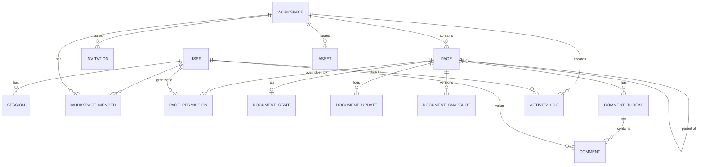

# CoNote – Database Schema

**Status:** Phase 1 Prisma 7 configuration and an intentionally empty baseline migration are implemented; the baseline migration has been reported successfully deployed and up to date. No application data models exist yet; the model design below remains planned for later phases.
**Last updated:** 2026-11-12

Decision IDs (`D#`, `U#`) are in [DECISIONS.md](DECISIONS.md). Persistence guarantees (`G1`–`G7`) are in [ARCHITECTURE.md](ARCHITECTURE.md) §8. REST resources that map to these models are in [API_CONTRACTS.md](API_CONTRACTS.md).

## 1. Conventions

| Topic | Convention |
|---|---|
| Database | PostgreSQL 17 (D18) |
| ORM | Prisma 7.10.1 (D18). The Phase 1 implementation uses the `prisma-client` generator with output under `packages/db/src/generated/prisma`, `@prisma/adapter-pg`, and `prisma.config.ts` for `DATABASE_URL`. Client generation, a real database query and the baseline migration workflow have been reported successful (U5/V8 evidence in HANDOVER.md). The model design below remains planned. |
| Primary keys | UUID generated by Prisma (`@default(uuid())`, `@db.Uuid`) (D29). Exception: `DocumentUpdate.seq` is a `BigInt` auto-increment. |
| Table names | `snake_case`, plural, via `@@map`. Column names are the Prisma field names (camelCase). |
| Timestamps | `timestamptz(6)`, stored in UTC. `createdAt` default `now()`; `updatedAt` via `@updatedAt`. |
| Emails | Stored **lowercase-normalized** (application normalizes; a `CHECK` enforces it). |
| Secrets | Passwords: Argon2id hash only. Session and invitation tokens: **SHA-256 hex of the token only**; raw tokens are never stored (D5, D30). |
| Soft delete | Pages only (D24). Comments are soft-deleted. Everything else is hard-deleted. |
| Constraints Prisma cannot express | Added by hand-edited SQL in the migration (listed in §5). |
| Locking | Document persistence uses `SELECT ... FOR UPDATE` through raw queries (Prisma has no native row-lock API) (§7). |

## 2. Entity relationship overview



## 3. Complete Prisma schema

```prisma
// packages/db/prisma/schema.prisma  (implemented Phase 1 shell; no models yet)

generator client {
  provider = "prisma-client"          // exact generator config confirmed in Phase 1 (U5)
  output   = "../generated/prisma"    // placeholder
}

datasource db {
  provider = "postgresql"             // connection URL configured in prisma.config.ts (U5)
}

// ───────────── Enums ─────────────

enum WorkspaceRole {
  OWNER
  ADMIN
  EDITOR
  COMMENTER
  VIEWER
}

enum PageAccessRole {
  NONE
  VIEWER
  COMMENTER
  EDITOR
}

enum InvitationStatus {
  PENDING
  ACCEPTED
  REVOKED
}

enum SnapshotKind {
  AUTO
  MANUAL
  PRE_RESTORE
}

enum AnchorStatus {
  ACTIVE
  DETACHED
}

enum AssetPurpose {
  PAGE_IMAGE
  AVATAR
}

enum AssetStatus {
  PENDING
  READY
}

// ───────────── Identity ─────────────

model User {
  id                String    @id @default(uuid()) @db.Uuid
  email             String    @unique @db.VarChar(254)
  passwordHash      String
  displayName       String    @db.VarChar(80)
  presenceColor     String    @db.Char(7)
  avatarAssetId     String?   @db.Uuid
  passwordChangedAt DateTime  @default(now()) @db.Timestamptz(6)
  lastLoginAt       DateTime? @db.Timestamptz(6)
  createdAt         DateTime  @default(now()) @db.Timestamptz(6)
  updatedAt         DateTime  @updatedAt @db.Timestamptz(6)

  avatarAsset         Asset?            @relation("UserAvatar", fields: [avatarAssetId], references: [id], onDelete: SetNull)
  sessions            Session[]
  memberships         WorkspaceMember[]
  createdWorkspaces   Workspace[]       @relation("WorkspaceCreatedBy")
  sentInvitations     Invitation[]      @relation("InvitationInvitedBy")
  acceptedInvitations Invitation[]      @relation("InvitationAcceptedBy")
  createdPages        Page[]            @relation("PageCreatedBy")
  deletedPages        Page[]            @relation("PageDeletedBy")
  pagePermissions     PagePermission[]  @relation("PermissionUser")
  grantedPermissions  PagePermission[]  @relation("PermissionCreatedBy")
  uploadedAssets      Asset[]           @relation("AssetUploadedBy")
  createdThreads      CommentThread[]   @relation("ThreadCreatedBy")
  resolvedThreads     CommentThread[]   @relation("ThreadResolvedBy")
  comments            Comment[]         @relation("CommentAuthor")
  deletedComments     Comment[]         @relation("CommentDeletedBy")
  createdSnapshots    DocumentSnapshot[] @relation("SnapshotCreatedBy")
  activities          ActivityLog[]     @relation("ActivityActor")

  @@map("users")
}

model Session {
  id                String    @id @default(uuid()) @db.Uuid
  userId            String    @db.Uuid
  tokenHash         String    @unique @db.Char(64)
  userAgent         String?   @db.VarChar(512)
  ipAddress         String?   @db.VarChar(45)
  createdAt         DateTime  @default(now()) @db.Timestamptz(6)
  lastSeenAt        DateTime  @default(now()) @db.Timestamptz(6)
  expiresAt         DateTime  @db.Timestamptz(6)   // idle expiry (sliding)
  absoluteExpiresAt DateTime  @db.Timestamptz(6)   // fixed maximum lifetime
  revokedAt         DateTime? @db.Timestamptz(6)

  user User @relation(fields: [userId], references: [id], onDelete: Cascade)

  @@index([userId, revokedAt])
  @@index([expiresAt])
  @@map("sessions")
}

// ───────────── Workspaces ─────────────

model Workspace {
  id          String   @id @default(uuid()) @db.Uuid
  name        String   @db.VarChar(100)
  createdById String?  @db.Uuid
  createdAt   DateTime @default(now()) @db.Timestamptz(6)
  updatedAt   DateTime @updatedAt @db.Timestamptz(6)

  createdBy    User?             @relation("WorkspaceCreatedBy", fields: [createdById], references: [id], onDelete: SetNull)
  members      WorkspaceMember[]
  invitations  Invitation[]
  pages        Page[]
  assets       Asset[]
  activityLogs ActivityLog[]

  @@map("workspaces")
}

model WorkspaceMember {
  id          String        @id @default(uuid()) @db.Uuid
  workspaceId String        @db.Uuid
  userId      String        @db.Uuid
  role        WorkspaceRole
  createdAt   DateTime      @default(now()) @db.Timestamptz(6)
  updatedAt   DateTime      @updatedAt @db.Timestamptz(6)

  workspace Workspace @relation(fields: [workspaceId], references: [id], onDelete: Cascade)
  user      User      @relation(fields: [userId], references: [id], onDelete: Cascade)

  @@unique([workspaceId, userId])
  @@index([userId])
  @@map("workspace_members")
}

model Invitation {
  id           String           @id @default(uuid()) @db.Uuid
  workspaceId  String           @db.Uuid
  email        String           @db.VarChar(254)
  role         WorkspaceRole
  tokenHash    String           @unique @db.Char(64)
  status       InvitationStatus @default(PENDING)
  invitedById  String?          @db.Uuid
  acceptedById String?          @db.Uuid
  expiresAt    DateTime         @db.Timestamptz(6)
  acceptedAt   DateTime?        @db.Timestamptz(6)
  revokedAt    DateTime?        @db.Timestamptz(6)
  createdAt    DateTime         @default(now()) @db.Timestamptz(6)

  workspace  Workspace @relation(fields: [workspaceId], references: [id], onDelete: Cascade)
  invitedBy  User?     @relation("InvitationInvitedBy", fields: [invitedById], references: [id], onDelete: SetNull)
  acceptedBy User?     @relation("InvitationAcceptedBy", fields: [acceptedById], references: [id], onDelete: SetNull)

  @@index([workspaceId, status])
  @@index([email])
  @@map("invitations")
}

// ───────────── Pages ─────────────

model Page {
  id            String    @id @default(uuid()) @db.Uuid
  workspaceId   String    @db.Uuid
  parentId      String?   @db.Uuid
  title         String    @default("Untitled") @db.VarChar(200)
  icon          String?   @db.VarChar(32)
  position      String    @db.VarChar(64)       // fractional-index key; sorts lexicographically among siblings
  createdById   String?   @db.Uuid
  createdAt     DateTime  @default(now()) @db.Timestamptz(6)
  updatedAt     DateTime  @updatedAt @db.Timestamptz(6)
  deletedAt     DateTime? @db.Timestamptz(6)
  deletedById   String?   @db.Uuid
  deleteBatchId String?   @db.Uuid               // identifies the subtree deletion operation

  workspace   Workspace          @relation(fields: [workspaceId], references: [id], onDelete: Cascade)
  parent      Page?              @relation("PageTree", fields: [parentId], references: [id], onDelete: Cascade)
  children    Page[]             @relation("PageTree")
  createdBy   User?              @relation("PageCreatedBy", fields: [createdById], references: [id], onDelete: SetNull)
  deletedBy   User?              @relation("PageDeletedBy", fields: [deletedById], references: [id], onDelete: SetNull)
  permissions PagePermission[]
  state       DocumentState?
  updates     DocumentUpdate[]
  snapshots   DocumentSnapshot[]
  threads     CommentThread[]
  assets      Asset[]
  activityLogs ActivityLog[]

  @@index([workspaceId, parentId, position])
  @@index([workspaceId, deletedAt])
  @@index([deleteBatchId])
  @@map("pages")
}

model PagePermission {
  id          String         @id @default(uuid()) @db.Uuid
  pageId      String         @db.Uuid
  userId      String         @db.Uuid
  role        PageAccessRole
  createdById String?        @db.Uuid
  createdAt   DateTime       @default(now()) @db.Timestamptz(6)
  updatedAt   DateTime       @updatedAt @db.Timestamptz(6)

  page      Page  @relation(fields: [pageId], references: [id], onDelete: Cascade)
  user      User  @relation("PermissionUser", fields: [userId], references: [id], onDelete: Cascade)
  createdBy User? @relation("PermissionCreatedBy", fields: [createdById], references: [id], onDelete: SetNull)

  @@unique([pageId, userId])
  @@index([userId])
  @@map("page_permissions")
}

// ───────────── Assets (images, avatars) ─────────────

model Asset {
  id           String       @id @default(uuid()) @db.Uuid
  workspaceId  String?      @db.Uuid              // null for avatars
  pageId       String?      @db.Uuid
  uploadedById String?      @db.Uuid
  purpose      AssetPurpose
  status       AssetStatus  @default(PENDING)
  objectKey    String       @unique @db.VarChar(512)
  contentType  String       @db.VarChar(127)
  sizeBytes    Int
  createdAt    DateTime     @default(now()) @db.Timestamptz(6)

  workspace    Workspace? @relation(fields: [workspaceId], references: [id], onDelete: Cascade)
  page         Page?      @relation(fields: [pageId], references: [id], onDelete: SetNull)
  uploadedBy   User?      @relation("AssetUploadedBy", fields: [uploadedById], references: [id], onDelete: SetNull)
  avatarOfUsers User[]    @relation("UserAvatar")

  @@index([workspaceId])
  @@index([pageId])
  @@index([status, createdAt])
  @@map("assets")
}

// ───────────── Collaborative document persistence (D15) ─────────────

model DocumentState {
  pageId               String   @id @db.Uuid
  foldedState          Bytes                         // compacted full Yjs state (updates up to foldedSeq merged in)
  persistedStateVector Bytes                         // coverage of foldedState + all stored DocumentUpdate rows
  foldedSeq            BigInt   @default(0)          // highest DocumentUpdate.seq merged into foldedState
  updatedAt            DateTime @updatedAt @db.Timestamptz(6)

  page Page @relation(fields: [pageId], references: [id], onDelete: Cascade)

  @@map("document_states")
}

model DocumentUpdate {
  seq       BigInt   @id @default(autoincrement())
  pageId    String   @db.Uuid
  update    Bytes                                    // incremental Yjs update (diff), never the full document per edit
  createdAt DateTime @default(now()) @db.Timestamptz(6)

  page Page @relation(fields: [pageId], references: [id], onDelete: Cascade)

  @@index([pageId, seq])
  @@map("document_updates")
}

model DocumentSnapshot {
  id             String       @id @default(uuid()) @db.Uuid
  pageId         String       @db.Uuid
  kind           SnapshotKind
  label          String?      @db.VarChar(120)
  state          Bytes                              // full Yjs state at capture time
  sizeBytes      Int
  createdById    String?      @db.Uuid              // null for AUTO
  contributorIds String[]     @db.Uuid              // distinct editors since previous snapshot
  createdAt      DateTime     @default(now()) @db.Timestamptz(6)

  page      Page  @relation(fields: [pageId], references: [id], onDelete: Cascade)
  createdBy User? @relation("SnapshotCreatedBy", fields: [createdById], references: [id], onDelete: SetNull)

  @@index([pageId, createdAt(sort: Desc)])
  @@map("document_snapshots")
}

// ───────────── Comments (D8) ─────────────

model CommentThread {
  id           String       @id @default(uuid()) @db.Uuid
  pageId       String       @db.Uuid
  anchorStart  Bytes                                 // encoded Yjs RelativePosition
  anchorEnd    Bytes                                 // encoded Yjs RelativePosition
  quotedText   String       @db.VarChar(500)         // text at creation time, for display when detached
  anchorStatus AnchorStatus @default(ACTIVE)
  createdById  String?      @db.Uuid
  resolvedById String?      @db.Uuid
  resolvedAt   DateTime?    @db.Timestamptz(6)
  createdAt    DateTime     @default(now()) @db.Timestamptz(6)
  updatedAt    DateTime     @updatedAt @db.Timestamptz(6)

  page       Page      @relation(fields: [pageId], references: [id], onDelete: Cascade)
  createdBy  User?     @relation("ThreadCreatedBy", fields: [createdById], references: [id], onDelete: SetNull)
  resolvedBy User?     @relation("ThreadResolvedBy", fields: [resolvedById], references: [id], onDelete: SetNull)
  comments   Comment[]

  @@index([pageId, resolvedAt])
  @@map("comment_threads")
}

model Comment {
  id          String    @id @default(uuid()) @db.Uuid
  threadId    String    @db.Uuid
  authorId    String?   @db.Uuid
  body        String                                  // plain text, 1–5000 chars (CHECK)
  createdAt   DateTime  @default(now()) @db.Timestamptz(6)
  updatedAt   DateTime  @updatedAt @db.Timestamptz(6)
  deletedAt   DateTime? @db.Timestamptz(6)
  deletedById String?   @db.Uuid

  thread    CommentThread @relation(fields: [threadId], references: [id], onDelete: Cascade)
  author    User?         @relation("CommentAuthor", fields: [authorId], references: [id], onDelete: SetNull)
  deletedBy User?         @relation("CommentDeletedBy", fields: [deletedById], references: [id], onDelete: SetNull)

  @@index([threadId, createdAt])
  @@map("comments")
}

// ───────────── Activity ─────────────

model ActivityLog {
  id          String   @id @default(uuid()) @db.Uuid
  workspaceId String   @db.Uuid
  pageId      String?  @db.Uuid
  actorId     String?  @db.Uuid
  action      String   @db.VarChar(64)               // dot-notation catalog, see §6
  metadata    Json?                                  // ids and non-sensitive context only
  createdAt   DateTime @default(now()) @db.Timestamptz(6)

  workspace Workspace @relation(fields: [workspaceId], references: [id], onDelete: Cascade)
  page      Page?     @relation(fields: [pageId], references: [id], onDelete: SetNull)
  actor     User?     @relation("ActivityActor", fields: [actorId], references: [id], onDelete: SetNull)

  @@index([workspaceId, createdAt(sort: Desc)])
  @@index([pageId, createdAt(sort: Desc)])
  @@index([actorId])
  @@map("activity_logs")
}
```

## 4. Model reference

### 4.1 Users and sessions

| Model | Purpose | Key constraints and rules |
|---|---|---|
| `User` | Account and profile | `email` unique, lowercase; display name 1–80 chars; `presenceColor` `#RRGGBB`. Account deletion is out of scope for the MVP. |
| `Session` | Server-side session | `tokenHash` unique (SHA-256 hex, 64 chars). Valid when `revokedAt IS NULL` and `now() < least(expiresAt, absoluteExpiresAt)`. `lastSeenAt`/`expiresAt` updates are throttled (at most about once a minute) to avoid a write per request. |

### 4.2 Workspaces and membership

| Model | Purpose | Key constraints and rules |
|---|---|---|
| `Workspace` | Container for pages | Name 1–100 chars. **No owner column**: the owner is the member with role `OWNER` (single source of truth). No slug; URLs use the UUID (D29). |
| `WorkspaceMember` | Membership and role | `@@unique(workspaceId, userId)`. **Exactly one `OWNER` per workspace** (partial unique index, §5). Ownership transfer changes two rows in one transaction. |
| `Invitation` | Pending/used invitation | Token stored as hash; **role cannot be `OWNER`**; at most one `PENDING` invitation per (workspace, email) (partial unique index); expires at `expiresAt` (default 7 days, D30). Status `EXPIRED` is derived from `expiresAt`, not stored. |

### 4.3 Pages and permissions

| Model | Purpose | Key constraints and rules |
|---|---|---|
| `Page` | Page metadata and tree | Title ≤ 200 chars; `parentId` null for root; `position` orders siblings (fractional index). **Same-workspace parent** and **no cycles** are enforced in the service layer in one transaction (recursive check) and covered by tests; optional DB hardening: composite FK (D24 notes). Maximum nesting depth: initial limit 10 (tunable). Soft delete: `deletedAt`, `deletedById`, `deleteBatchId` (all pages of one deletion share the batch so restore restores exactly that set). |
| `PagePermission` | Per-user override | `@@unique(pageId, userId)`; role `NONE`/`VIEWER`/`COMMENTER`/`EDITOR` (D23). Target must be a workspace member and must not be `ADMIN`/`OWNER` (service-level rule). Removing a member deletes their overrides in that workspace (same transaction). |
| `Asset` | Image/avatar metadata | `objectKey` unique; status `PENDING` until the upload is confirmed (`READY`). Orphan cleanup job (§8). |

### 4.4 Collaborative documents

| Model | Purpose | Key constraints and rules |
|---|---|---|
| `DocumentState` | One row per page; compacted state | PK = `pageId` (1:1 with `Page`). Created lazily by the collab server on first store (`INSERT ... ON CONFLICT DO NOTHING`). Doubles as the **per-page lock row** (§7). |
| `DocumentUpdate` | Append-only incremental updates | `seq` increases monotonically. `CHECK (octet_length("update") > 0)`. |
| `DocumentSnapshot` | Version history | Immutable after insert (no update path in code). `contributorIds` = distinct editor ids since the previous snapshot. |

### 4.5 Comments

| Model | Purpose | Key constraints and rules |
|---|---|---|
| `CommentThread` | Anchored thread | Anchors are encoded Yjs Relative Positions (D8). `anchorStatus` is set to `DETACHED` by the collab server when it finds the anchor unresolvable after a restore (U8); clients also resolve anchors live and show detached threads. Resolved = `resolvedAt` not null. |
| `Comment` | Message in a thread | The first comment is the thread's root message, created in the same transaction as the thread. Body 1–5000 chars (`CHECK`). Soft-deleted (`deletedAt`); deleted bodies are not returned by the API. |

### 4.6 Activity

`ActivityLog` is workspace-scoped. Authentication/security events (login, password change, session revocation) are **not** stored here; they go to structured application logs. Retention/pruning of activity and AUTO snapshots is U11.

## 5. Constraints added by SQL migration

Prisma cannot express these; they are added to the migration files by hand in Phase 1/2/3 as each table is created, and covered by database tests:

```sql
-- users
ALTER TABLE users ADD CONSTRAINT users_email_lowercase CHECK (email = lower(email));
ALTER TABLE users ADD CONSTRAINT users_presence_color_format CHECK ("presenceColor" ~ '^#[0-9A-Fa-f]{6}$');

-- At most one OWNER per workspace.
CREATE UNIQUE INDEX workspace_members_one_owner
  ON workspace_members ("workspaceId") WHERE role = 'OWNER';

-- Same-workspace parent reference. The unique key is needed as the target
-- of the composite foreign key; NULL parentId is valid for root pages.
ALTER TABLE pages
  ADD CONSTRAINT pages_workspace_id_id_unique UNIQUE ("workspaceId", id);
ALTER TABLE pages
  ADD CONSTRAINT pages_parent_same_workspace_fk
  FOREIGN KEY ("workspaceId", "parentId")
  REFERENCES pages ("workspaceId", id)
  ON DELETE CASCADE;

-- At least one OWNER per surviving workspace at transaction commit.
-- Implement assert_workspace_has_exactly_one_owner() as a PL/pgSQL trigger
-- function. It checks that the affected workspace still exists and, if so,
-- that exactly one workspace_members row has role='OWNER'.
-- Install deferred constraint triggers on:
--   workspaces AFTER INSERT OR UPDATE (check NEW.id)
--   workspace_members AFTER INSERT OR UPDATE OR DELETE
-- For membership UPDATE/DELETE, check both OLD.workspaceId and NEW.workspaceId
-- (when present). The triggers must be DEFERRABLE INITIALLY DEFERRED so a
-- workspace + owner can be created together and ownership can be transferred
-- within one transaction. Workspace deletion is allowed because the deferred
-- check sees that the workspace no longer exists.

-- invitations
ALTER TABLE invitations ADD CONSTRAINT invitations_role_not_owner CHECK (role <> 'OWNER');
ALTER TABLE invitations ADD CONSTRAINT invitations_email_lowercase CHECK (email = lower(email));
CREATE UNIQUE INDEX invitations_one_pending_per_email ON invitations ("workspaceId", email) WHERE status = 'PENDING';

-- pages
ALTER TABLE pages ADD CONSTRAINT pages_not_own_parent CHECK ("parentId" IS NULL OR "parentId" <> id);
-- Also add pages_workspace_id_id_unique and pages_parent_same_workspace_fk above.

-- document data and comments
ALTER TABLE document_updates ADD CONSTRAINT document_updates_nonempty CHECK (octet_length("update") > 0);
ALTER TABLE comments ADD CONSTRAINT comments_body_length CHECK (char_length(body) BETWEEN 1 AND 5000);
```

## 6. Activity action catalog

`ActivityLog.action` values (validated in code; adding one needs no migration):

| Group | Actions |
|---|---|
| Workspace | `workspace.created`, `workspace.updated` |
| Members | `member.invited`, `member.joined`, `member.role_changed`, `member.removed`, `member.left`, `ownership.transferred`, `invitation.revoked` |
| Pages | `page.created`, `page.renamed`, `page.moved`, `page.deleted`, `page.restored`, `page.purged`, `page.permission_set`, `page.permission_removed` |
| Editing | `page.edited` (throttled: at most one per user per page per 5 minutes; written by the collab server) |
| Versions | `version.created`, `version.restored` |
| Comments | `comment.thread_created`, `comment.thread_resolved`, `comment.thread_reopened` |

`metadata` holds ids and non-sensitive context only (no tokens, no email bodies, no document text).

## 7. Collaborative document persistence and recovery (detail)

This section applies [ARCHITECTURE.md](ARCHITECTURE.md) §8 to the tables above. It is the baseline design; behaviours that depend on Hocuspocus hooks are verified in the Phase 1 spike (U3).

**Rule:** all writes to `document_updates` and `document_states` for a page happen inside a transaction that holds a row lock on that page's `document_states` row. This serializes stores and compaction per page across collab instances, so within a page `seq` order equals commit order and recovery never sees a gap-then-fill ordering problem.

**Store (diff append):**

```sql
-- illustrative; executed through a raw query in packages/db inside a transaction
INSERT INTO document_states ("pageId", "foldedState", "persistedStateVector", "foldedSeq", "updatedAt")
VALUES ($1, $2 /* empty doc update */, $3 /* empty vector */, 0, now())
ON CONFLICT ("pageId") DO NOTHING;

SELECT "foldedState", "persistedStateVector", "foldedSeq"
FROM document_states WHERE "pageId" = $1 FOR UPDATE;

-- application: diff = Y.encodeStateAsUpdate(liveDoc, persistedStateVector)
-- if diff is non-empty:
INSERT INTO document_updates ("pageId", "update") VALUES ($1, $4 /* diff */);
UPDATE document_states
SET "persistedStateVector" = $5 /* per-client max(previous, liveDoc vector) */, "updatedAt" = now()
WHERE "pageId" = $1;
```

**Compaction:** under the same lock: read `foldedState` and all rows with `seq > foldedSeq`, merge (`Y.mergeUpdates`), write `foldedState` and `foldedSeq = max(seq merged)`, delete rows with `seq <= foldedSeq`. One transaction: failure leaves the previous state and rows unchanged (G4).

**Recovery:** read `foldedState`, then `SELECT "update" FROM document_updates WHERE "pageId" = $1 AND seq > foldedSeq ORDER BY seq`, apply all to a fresh `Y.Doc`. Applying an update twice is harmless (Yjs updates are idempotent), so a recovery that overlaps a concurrent compaction stays correct.

**Snapshots:** `Y.encodeStateAsUpdate(liveDoc)` stored in `document_snapshots.state` (full state, GC left at default). Restore reads a snapshot, applies its content as one transaction to the live document, and never deletes snapshots (G7).

**Sizing and growth:** the full-document write happens only at compaction and snapshot time, not per edit. Growth, compaction thresholds and snapshot retention are measured and tuned in Phases 9–10 (PERF-05, PERF-06); no sizes are assumed here.

## 8. Cascade behaviour

| Parent deleted | Effect |
|---|---|
| `User` | Sessions, memberships, page permissions **deleted**. Authored/created references (`createdById`, `authorId`, `actorId`, etc.) **set to null**. (User deletion itself is out of scope for the MVP.) |
| `Workspace` | Members, invitations, pages (and, through pages, document data, permissions, threads, comments, snapshots), assets rows and activity logs **deleted**. Object-storage binaries are removed by a cleanup job. |
| `Page` | Child pages (cascade), permissions, document state, updates, snapshots, threads (and comments) **deleted**. `ActivityLog.pageId` and `Asset.pageId` set to null. Hard deletion happens only by purge (D24), a workspace deletion, or the retention job. |
| `CommentThread` | Comments deleted. |
| `Asset` | `User.avatarAssetId` set to null. |

**Scheduled cleanup jobs** (implemented in `apps/api`, Phases 2–10; intervals tunable): delete expired/revoked sessions past a grace period; mark/delete stale `PENDING` invitations; purge soft-deleted pages after the retention period (initial 30 days, D24); delete `PENDING` assets that were never completed and orphaned storage objects; retention for activity logs and AUTO snapshots per U11.

## 9. Query design notes

| Need | Approach | Index |
|---|---|---|
| Authenticate request | Lookup by `tokenHash` | unique index on `tokenHash` |
| Effective page role (D23) | One query: recursive CTE walking `parentId` upwards from the page, joined with `page_permissions` for the user and the user's `workspace_members` role; result computed by the shared pure function | `pages(id)`, `page_permissions(pageId, userId)` unique, `workspace_members(workspaceId, userId)` unique |
| Page tree for a workspace | Flat list of non-deleted pages ordered by `(parentId, position)`, then filtered by effective role | `pages(workspaceId, parentId, position)` |
| Trash listing | Pages with `deletedAt` set and no deleted parent in the same batch | `pages(workspaceId, deletedAt)` |
| Document load | `document_states` by PK + updates by `(pageId, seq)` | `document_updates(pageId, seq)` |
| Version list | Latest first per page | `document_snapshots(pageId, createdAt desc)` |
| Comment list | Open/resolved threads per page, comments per thread | `comment_threads(pageId, resolvedAt)`, `comments(threadId, createdAt)` |
| Activity feed | Newest first per workspace/page | `activity_logs(workspaceId, createdAt desc)`, `(pageId, createdAt desc)` |

## 10. Validation rules summary

| Field | Rule |
|---|---|
| Email | RFC-valid, ≤ 254 chars, lowercase-normalized, unique |
| Password | 12–128 characters (initial policy; tunable in Phase 2); Argon2id hash stored |
| Display name | 1–80 characters, trimmed |
| Presence color | `#RRGGBB` |
| Workspace name | 1–100 characters |
| Page title | 0–200 characters (empty displays as "Untitled" in the UI) |
| Page icon | ≤ 32 characters (single emoji or short identifier) |
| Nesting depth | ≤ 10 levels (initial) |
| Comment body | 1–5000 characters, plain text |
| Snapshot label | ≤ 120 characters |
| Invitation role | not `OWNER` |

## 11. Migration and seeding plan

- Migrations are created per phase, with the models that phase introduces: Phase 2 `User`, `Session`; Phase 3 `Workspace`, `WorkspaceMember`, `Invitation`, `Page`, `PagePermission`, `ActivityLog`; Phase 4 `Asset`; Phase 5 `DocumentState`, `DocumentUpdate`; Phase 8 `DocumentSnapshot`, `CommentThread`, `Comment`.
- The Phase 1 spike uses a **throwaway** schema and is not part of the migration history.
- Development seed data (Phase 3 onward) is generated by a script and contains no real data.
- Raw-SQL constraints (§5) are included in the same migration as the table they apply to.
