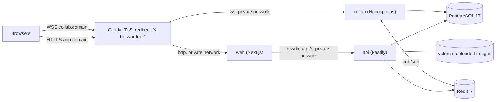

# CoNote – Deployment

**Status (Phase 11, 2026-11-26): prepared, NOT deployed.** The production packaging, configuration, operations and verification procedure are complete and were rehearsed on a production-topology stack (HTTPS, a separate `wss://` collaboration origin, `__Host-` cookies, production builds) on one machine (§16.B). **No real deployment exists**: no server, hosting account, domain or credentials were available to the assistant, and the assistant's sandbox could reach only package registries and GitHub (§16.A, §18). Nothing in this document claims that a public instance is running.
**Last updated:** 2026-11-26 (Phase 11)

Decision IDs (`D#`, `U#`) are in [DECISIONS.md](DECISIONS.md); architecture in [ARCHITECTURE.md](ARCHITECTURE.md); protocol in [WEBSOCKET_PROTOCOL.md](WEBSOCKET_PROTOCOL.md); test evidence in [TESTING.md](TESTING.md). The hosting target is **proposed as D71** (a single server running Docker Compose behind Caddy, §13) and awaits the owner's acceptance; the rest of the document stays provider-neutral where it can (images, configuration, operations, runbooks).

**Where things are**

| Need | File |
|---|---|
| Production Compose stack (one server) | `infra/docker-compose.prod.yml` |
| Reverse proxy and automatic TLS | `infra/Caddyfile` |
| Production variables (placeholders only) | `.env.production.example` |
| Backup / restore drill | `scripts/backup-postgres.sh`, `scripts/restore-drill.sh` |
| Black-box production verification | `pnpm verify:deployment` (`apps/collab/scripts/verify-deployment.ts`) |
| Browser journeys against a deployment | `pnpm test:e2e` with `E2E_BASE_URL` (§15) |

## 1. Environments

| Environment | Purpose | Infrastructure |
|---|---|---|
| Local development | Day-to-day work | Docker Compose for PostgreSQL and Redis; apps run on the host with `pnpm`. S3-compatible storage is deferred (D37/U7) |
| CI | Automated tests | Service containers/Compose (TESTING.md §9) |
| Staging (optional, recommended before Phase 11 sign-off) | Production-like verification | Same topology as production, separate data and secrets |
| Production | Live system | Reference topology (§2) on the target proposed in D71 (§13); **not provisioned yet** |

### Local Compose services and ports (from ARCHITECTURE §15)

| Service | Port(s) |
|---|---|
| `web` | 3000 |
| `api` | 4000 |
| `collab` instance 1 / 2 | 4100 / 4101 |
| PostgreSQL 17 | 5433 on the host → 5432 in the Compose container |
| Redis 7.x | 6379 |
| S3-compatible storage (MinIO if practical; not included in Phase 1 Compose, D37) | 9000 (API) / 9001 (console), when added |

## 2. Reference production topology



Rules:

1. **Only two public names:** `app.<domain>` (web) and `collab.<domain>` (WebSocket), both served by Caddy on ports 80/443. **The API, PostgreSQL and Redis publish no ports** (`infra/docker-compose.prod.yml` publishes only Caddy's). The browser never talks to the API directly: it calls `/api/*` on the web origin and Next.js forwards it (D6), so the session cookie is host-only on the app origin and no CORS is needed for REST. The browser talks to the collaboration origin directly, authenticated by a 60-second token (D22), with the `Origin` header checked (D25).
2. TLS terminates at Caddy. The collab entry supports WebSocket upgrade and long-lived connections. **Sticky sessions are not required** (D2).
3. `web` and `api` are stateless **except image storage**: uploaded images are files on a local volume (D55), so **run exactly one `api` instance** until an S3-compatible adapter exists (U7). `collab` instances are interchangeable; adding instances increases connection capacity and availability, **not per-document CPU capacity** (D2). The reference stack runs one of each.
4. PostgreSQL is the **only durable store of application data** (D14); the image volume is the only other durable state. Redis is disposable.

## 3. Container images

All images are built from `infra/Dockerfile.node` (targets `migrate`, `api`, `collab`) and `infra/Dockerfile.web` with the repository root as the build context.

| Image | Dockerfile target | Notes |
|---|---|---|
| web | `Dockerfile.web` | Next.js standalone build, non-root. **Build arguments `API_INTERNAL_URL` and `APP_URL` are baked into the build** (rewrite destination; HSTS and the Content-Security-Policy). `APP_URL` must be the real public origin: an image built with the default `http://localhost:3000` ships without HSTS and with `ws:` allowed (found and fixed in Phase 11) |
| api | `Dockerfile.node` / `api` | Fastify, non-root; `/data/assets` is created owned by the `node` user so a mounted volume is writable (fixed in Phase 11) |
| collab | `Dockerfile.node` / `collab` | Hocuspocus, non-root |
| migrate (one-off) | `Dockerfile.node` / `migrate` | Runs `prisma migrate deploy` only; used as a release step |

Properties: multi-stage, `pnpm install --frozen-lockfile`, Node.js 24 (D16), non-root, no secrets in images (`.dockerignore` excludes `.env` and `.env.*`). Compose pins the data-service images by major tag (`postgres:17-alpine`, `redis:7-alpine`, `caddy:2-alpine`); **pin exact tags or digests when a release is cut** (U1, not done). Tag application images with the commit SHA when building in CI (not set up: the reference stack builds on the server).

**Status: the Dockerfiles and `docker-compose.prod.yml` were NOT built or run in Phase 11** (no Docker in the assistant's environment). The Compose file was parsed as YAML, its injected environment was validated against the real environment schemas of all three services (§16.B), and the Caddyfile was validated with Caddy 2.6.2. The first `docker compose build` and `up` on a real machine is the first real test of the images; record its result in §16.A.

Health checks: liveness (`/health`) never depends on a dependency; API readiness (`/ready`) requires PostgreSQL and a compatible schema, not Redis; collab reports PostgreSQL readiness and Redis-degraded multi-instance capability separately (API_CONTRACTS.md §13). The Compose health checks use `/ready` for the API and `/health` for collab and web.

## 4. Configuration

Environment variable names for shared, API, collab and web are **implemented as of Phase 1** (see `.env.example` and D40): `NODE_ENV`, `LOG_LEVEL`, `DATABASE_URL`, `REDIS_URL`, `PORT`, `APP_URL`, `ALLOWED_ORIGINS`, `COLLAB_PORT`, `API_INTERNAL_URL`, and (Phase 2) `TRUST_PROXY`, `SESSION_IDLE_TTL_DAYS`, `SESSION_ABSOLUTE_TTL_DAYS`, and (Phase 4) `ASSET_STORAGE_DIR`. All other names below remain provisional until the phase that uses them. Values shown are the initial defaults from DECISIONS.md/WEBSOCKET_PROTOCOL.md; "—" means no default and must be set. Secrets are never committed; production secrets come from the chosen secret store (platform secrets or an encrypted env file on a VM).

### Shared

| Variable | Purpose | Default |
|---|---|---|
| `NODE_ENV` | `development` / `test` / `production` | — |
| `LOG_LEVEL` | pino level | `info` |
| `DATABASE_URL` | PostgreSQL connection string | — (secret) |
| `REDIS_URL` | Redis connection string | — (secret) |

### `apps/web`

| Variable | Purpose | Default |
|---|---|---|
| `APP_URL` | Public web origin. **Resolved at build time** for HSTS and the Content-Security-Policy (`infra/Dockerfile.web` build argument `APP_URL`); `https://` in production | — |
| `API_INTERNAL_URL` | Internal API URL used by `rewrites()` and server-side calls (D6). **Resolved at build time for the rewrite** (`next build`; `infra/Dockerfile.web` takes it as the build argument `API_INTERNAL_URL`); the runtime value is used for server-side calls | — |

### `apps/api`

| Variable | Purpose | Default |
|---|---|---|
| `PORT` | Listen port (binds `0.0.0.0` inside the container) | `4000` |
| `APP_URL` | Public web origin; used for invitation links and the Origin allow-list. **`https://` in production** | — |
| `ALLOWED_ORIGINS` | Origin allow-list for CSRF/CORS (D25), comma-separated; every entry `https://` in production | `APP_URL` |
| `TRUST_PROXY` | Comma-separated proxy IPs / CIDRs / `loopback` / `linklocal` / `uniquelocal` whose `X-Forwarded-For` is trusted (D43). **Production requires a reverse proxy in front of the web app that sets `X-Forwarded-For`; the web app must be reachable only through it** (ARCHITECTURE §10.3). The Compose file uses `uniquelocal` (the private Docker network) | empty (trust none) |
| `SESSION_IDLE_TTL_DAYS` / `SESSION_ABSOLUTE_TTL_DAYS` | Session lifetimes in days, 1–365 (D5, D42) | `7` / `30` |
| `ACTIVITY_LOG_RETENTION_DAYS` | Activity-log rows older than this many days are deleted by an API job (every 6 hours), 7–3650 (D69) | `365` |
| `ASSET_STORAGE_DIR` | Directory of the local-disk image storage (D55). **A persistent volume in production; one API instance only.** The API image sets `/data/assets` and the Compose file mounts a named volume there | `.data/assets` (development) |
| `COLLAB_URL` | WebSocket address of the collaboration server, returned by `PAGE-10` as `collabUrl`. **`wss://collab.<domain>` in production**; the API refuses to start if it is `ws://` or points at this machine while `APP_URL` is public (D72) | `ws://localhost:4100` |
| `COLLAB_JWT_PRIVATE_KEY` | Ed25519 private key as a **JWK containing `kid`**, one line of JSON, for signing collaboration tokens (D22). Without it `PAGE-10` answers `503` | — (secret) |
| *(not variables)* | Session cookie name `__Host-conote_session` in production (D42); Argon2id parameters m = 19456 KiB, t = 2, p = 1; token lifetime 60 s; invitation lifetime 7 days (D30); trash retention 30 days (D24); image types and size limits (shared constants) | — |

`ASSET_*` policy variables, `S3_*`, `EMAIL_ADAPTER`, `COLLAB_PUBLIC_URL`, `COLLAB_JWT_KID` and `COLLAB_JWT_TTL_SECONDS` that earlier drafts of this document listed **do not exist**; object storage and e-mail are not implemented (U6, U7).

### `apps/collab`

| Variable | Purpose | Default |
|---|---|---|
| `COLLAB_PORT` | Listen port (binds `0.0.0.0`) | `4100` |
| `APP_URL` | Public web origin | — |
| `COLLAB_ALLOWED_ORIGINS` | WebSocket `Origin` allow-list; every entry `https://` in production | `APP_URL` |
| `COLLAB_JWT_PUBLIC_KEYS` | JSON list of Ed25519 **public** JWKs `{ kty, crv, x, kid }`; several allowed (rotation, §5). A private key (`d`) here is refused | — |
| `COLLAB_REVALIDATE_INTERVAL_MS` | Periodic revalidation (D22) | `60000` |
| `COLLAB_STORE_DEBOUNCE_MS` / `COLLAB_STORE_MAX_DEBOUNCE_MS` | Store debounce (D15) | `2000` / `10000` |
| `COLLAB_COMPACT_UPDATE_COUNT` | Compaction threshold (D15) | `200` |
| `COLLAB_AUTO_SNAPSHOT_INTERVAL_MS` / `COLLAB_AUTO_SNAPSHOT_KEEP` | Automatic version snapshots (D62) | see `.env.example` |
| `COLLAB_EDIT_ACTIVITY_INTERVAL_MS` / `COLLAB_RESTORE_BARRIER_TTL_MS` | Edit-activity log interval; restore write gate lifetime | `300000` / `30000` |
| `COLLAB_CLUSTER_ENABLED` | Cross-instance synchronization through Redis (D64). `false` for a single instance | `true` |
| `COLLAB_INSTANCE_ID` | Name in logs and in the Redis protocol; letters, digits, `.`, `-`, `_`, at most 64. **Set a stable, unique value per instance** | random per process |
| `COLLAB_REDIS_PREFIX` | Prefix of the document channels. All instances of one deployment **must share it**; two deployments on one Redis must differ | `conote:collab` |
| `COLLAB_CLUSTER_INITIAL_SYNC_TIMEOUT_MS` | How long a document load waits for a peer's state (D2) | `1000` |
| `COLLAB_CLUSTER_RESYNC_INTERVAL_MS` | Anti-entropy interval (D64); `0` turns the timer off | `30000` |
| `COLLAB_CLUSTER_STORE_REPLICATED` | Also store changes that arrived from another instance (D65) | `true` |
| `COLLAB_CONNECTION_TIMEOUT_MS` | Close a connection that sent nothing for this long | `60000` |
| `COLLAB_MAX_PAYLOAD_BYTES` | Largest accepted message | `1048576` |
| `COLLAB_MAX_CONNECTIONS` / `COLLAB_MAX_CONNECTIONS_PER_USER` | Connection limits **per instance** | `5000` / `50` |
| `COLLAB_MAX_MESSAGES_PER_SECOND` / `COLLAB_MAX_AWARENESS_PER_SECOND` | Per-connection message and presence limits | `100` / `30` |
| `COLLAB_SHUTDOWN_TIMEOUT_MS` | Time allowed for the store flush at SIGTERM | `10000` |

### Production transport rules (D72, Phase 11)

With `NODE_ENV=production` all three services refuse to start when a **non-loopback** `APP_URL` or allow-list entry is not `https://`, when a non-loopback `COLLAB_URL` is not `wss://`, or when `COLLAB_URL` points at this machine while `APP_URL` is public (the unset default would otherwise slip through). Loopback hosts (`localhost`, `*.localhost`, `127.0.0.1`, `[::1]`) are exempt so the local Docker `apps` profile and local production-mode runs keep working. The error names the variable and the rule, never the value. Tests: `packages/shared/src/shared.test.ts` (6).

### Redis names

| Item | Name |
|---|---|
| Access-event channel | `conote:events:access` |
| Page-event channel | `conote:events:page` |
| Rate-limit key prefix | `conote:rl:` |
| Document channels | `<COLLAB_REDIS_PREFIX>:<documentName>`, for example `conote:collab:page:<pageId>` |
| Per-instance reply channels | `<COLLAB_REDIS_PREFIX>#reply:<COLLAB_INSTANCE_ID>` |

## 5. Secrets and keys

| Secret | Handling |
|---|---|
| `POSTGRES_PASSWORD`, `REDIS_PASSWORD` | Generate with `openssl rand -hex 24` (hex avoids URL-escaping problems in the connection strings). Live only in `.env.production` on the server (`chmod 600`) |
| **Collaboration JWT key pair (Ed25519)** | Generate with `node scripts/generate-collab-keys.mjs` (prints two lines; `--write` puts them into a local `.env`). The **API holds the private key** (`COLLAB_JWT_PRIVATE_KEY`); **collab holds public keys only** (`COLLAB_JWT_PUBLIC_KEYS`, D22) |
| Session secrets | Sessions are random opaque tokens stored hashed; there is no signing secret for sessions |
| TLS certificates | Obtained and renewed by Caddy (Let's Encrypt); the account and certificates live in the `caddy-data` volume (back it up or accept re-issuing) |

No secret appears in the repository, images, logs or CI output. `.env.example` and `.env.production.example` contain placeholders only; `.env`, `.env.*` (except the two examples) are git-ignored and docker-ignored. The logger redacts cookies, authorization headers, passwords and tokens; a scan of all service logs from the Phase 11 rehearsal found none of the test password, JWT text, session cookie, private-key material or document text (§16.B).

**Rotating the collaboration signing key** (tested in Phase 11 against the real verifier: `apps/collab/src/token-rotation.test.ts`, 5 tests):

1. Generate a new pair with a **new `kid`**.
2. Put **both** public keys in `COLLAB_JWT_PUBLIC_KEYS` (a JSON list) and restart collab. Both `kid`s are accepted. *Do this first: a collab server that does not yet know the new key refuses the API's new tokens.*
3. Put the new private key in `COLLAB_JWT_PRIVATE_KEY` and restart the API.
4. Wait longer than a token lives (60 s plus clock tolerance; five minutes is generous), then remove the old public key and restart collab. Tokens of the old key are now refused; the new ones keep working.

Suspected compromise of the private key: do steps 1–4 immediately without the wait, and revoke sessions if needed (AUTH-05/06 per user; deleting rows in `sessions` revokes all).

## 6. Reverse proxy / load balancer requirements

The reference stack uses **Caddy** (`infra/Caddyfile`), which satisfies all of the following by default; any other proxy must too.

**Web entry (`app.<domain>`):** HTTPS only; HTTP → HTTPS redirect; sets `X-Forwarded-For`/`-Proto`/`-Host` and **overwrites** client-supplied values; no request-size limit smaller than the API's (images are uploaded through this entry, `ASSET-04`, up to the image size limit). **Client address through the chain (Caddy → Next.js rewrite → API), checked in Phase 11 on the one-machine rehearsal** (all hops on loopback, `TRUST_PROXY=loopback`): the Next.js rewrite **does** forward `X-Forwarded-For`, and the API's rate-limit bucket key then holds the forwarded address (a request carrying `X-Forwarded-For: 203.0.113.7` produced the Redis key `conote:rl:POST/api/v1/auth/login-203.0.113.7`); through Caddy the bucket is the real client address, and an `X-Forwarded-For` value **sent by the client** created no bucket, so Caddy replaced it. **Not yet verified on the real Docker network** (`TRUST_PROXY=uniquelocal`, private addresses): repeat the check after the first deployment (§18, item 6). If the header were lost, every user would share one rate-limit bucket.

**Collab entry (`collab.<domain>`):**

- WebSocket upgrade supported end-to-end and `Origin` forwarded unchanged. The server closes silent connections itself (`COLLAB_CONNECTION_TIMEOUT_MS`); a proxy idle timeout must not be shorter than the clients' ping interval (the interval was not measured; Caddy has no default idle cut-off for proxied WebSockets).
- Any instance may serve any document: round-robin or least-connections is correct. Sticky routing is not implemented (D67, PERFORMANCE §8).
- When an instance stops answering `/health`, stop sending it new connections (Caddy: `health_uri`, set in the Caddyfile).
- Per-IP connection-rate limiting at the edge in addition to the application's per-instance limits: **not configured** (known limitation).

## 7. Data services

### PostgreSQL 17 (durable source of truth)

- Version 17 (supported by Prisma; D18). The Compose stack runs `postgres:17-alpine` with a named volume `postgres-data`, no published port, and a password.
- **Backups (reference stack):** `scripts/backup-postgres.sh` makes a logical dump (`pg_dump -Fc`) through the running container into a private directory. **Schedule it** (cron or a systemd timer; daily is the suggested minimum, chosen by the owner) and **copy the dumps off the server, encrypted**: a dump holds every user's data and password hashes. A logical daily dump gives a recovery point of up to one day; continuous WAL archiving for point-in-time recovery is the upgrade path and is **not set up**. Nothing in Phase 11 scheduled or encrypted backups.
- **Restore drill (AC-11.3):** `scripts/restore-drill.sh <dump>` restores into a scratch database `conote_restore_drill` and compares **every table** (row count and an MD5 of the sorted row texts, which includes `document_states` and `document_updates`) with the live database, then drops the scratch database. It never writes to the live database. Executed in Phase 11 against the rehearsal database on PostgreSQL 16: 15 tables identical; a negative control (one row changed after the dump) was reported as a failure (§16.B). **Not yet run on a real deployment**: do it once after the first backup and record the time (§16.A). The drill proves the data restores; a full recovery (a new server, `up -d` against the restored data, `pnpm verify:deployment`) is the remaining step of the procedure and was not rehearsed.
- Connection limits: the defaults of Prisma's pool apply per process; the reference stack has one `api` and one `collab`. `collab` uses short row-locked transactions per page (DATABASE_SCHEMA §7).
- Migrations are applied only by the migrate job (§8). The application and the migrate job use the **same database role** in the reference stack; separate roles (the application unable to alter schema) are recommended and not done (known limitation).

### Redis 7.x (disposable)

- Used for Hocuspocus fan-out, rate limiting and access events (D2, D14). Correctness never depends on its contents.
- The Compose stack runs `redis:7-alpine` with **no persistence, a password, `maxmemory 128mb` and `noeviction`**. Persistence (RDB/AOF) is not relied upon. Instances reconnect after a Redis restart, but Pub/Sub messages missed during the outage are not replayed; each instance runs the recovery of D64 when Redis returns and every `COLLAB_CLUSTER_RESYNC_INTERVAL_MS`.
- `noeviction` means a full Redis refuses writes instead of dropping rate-limit counters; the document channels carry no stored data. At 3 instances and 20 changes per second on one document Redis handled about 130 commands and 44 KB per second (PERFORMANCE §8); 128 MB was not load-tested.

### Uploaded images (local disk, D55)

- Image files live on the `assets` volume mounted at `/data/assets` of the **single** `api` container; the database holds only their metadata (`assets` table). **Back the volume up together with the database**: a restored database without the files shows broken images, and files without the database are unreferenced. `scripts/backup-postgres.sh` does **not** include the volume (add `docker run --rm -v conote-prod_assets:/data -v "$PWD/backups":/b alpine tar czf /b/assets-$(date -u +%Y%m%dT%H%M%SZ).tar.gz -C /data .`; the volume name follows the Compose project name `conote-prod`; not executed in Phase 11).
- S3-compatible storage (D10) is **not implemented** (U7 open); it is required before running more than one API instance.

## Health checks and degraded operation

- `GET /health` is liveness only: it reports whether the process is alive and does not fail because a dependency is unavailable.
- API `GET /ready` requires PostgreSQL connectivity and a compatible schema. Redis health is included as a separate dependency field; Redis failure alone does not remove the API from service.
- Collab exposes equivalent liveness and readiness diagnostics. PostgreSQL is required for safe hydration and durable stores. Redis-down is reported as `degraded` by `/ready` for multi-instance propagation. **As built, instances keep serving their own clients during an outage** (D64 item 6) rather than refusing; this is a decision awaiting the owner's acceptance.
- Redis-dependent API features must follow the scoped failure policy in API_CONTRACTS.md: bounded fallback only when explicitly safe; security-sensitive rate limits fail closed rather than silently disabling protection.
- Monitoring and load balancer decisions must use the readiness signal for the service being routed to, not a shared all-dependencies-green check.

## 8. Release procedure

On the server, from the repository root (`$C` = `docker compose --env-file .env.production -f infra/docker-compose.prod.yml`):

1. CI passes on the commit (lint, typecheck, tests).
2. `git pull` the release commit; `$C config > /dev/null` (fails on a missing variable).
3. **Back up first:** `scripts/backup-postgres.sh` (and the assets volume, §7).
4. `$C build` (builds `web` with the production `APP_URL`).
5. **Migrate:** `$C run --rm migrate` — `prisma migrate deploy`, which applies only pending migrations and never resets or drops anything. **Do not run any destructive migration or any command such as `migrate reset` or `db push --accept-data-loss` against production without explicit owner approval.** Migrations follow expand → deploy → contract so the previous application version keeps working during rollout; destructive changes go in a later release.
6. `$C up -d` (recreates changed containers; `web` and `api` restart in seconds; for `collab` see §9).
7. Run `pnpm verify:deployment` (§15) and watch `$C logs --tail 100 api collab` for errors.
8. Record the release (commit SHA, time, result) in HANDOVER.md or release notes. **Rollback:** check out the previous commit, `$C build`, `$C up -d`; database rollback is by forward-fix or by restore from the backup of step 3, never by manual schema edits.

## 9. Collab operations

- **Graceful shutdown (SIGTERM):** the instance stops accepting connections, sends `server.shutting_down`, flushes stores for all loaded documents, closes connections with the "restarting" close code, then exits. Orchestrator termination grace period must exceed the flush time observed in Phase 9.
- **Rolling restarts:** drain one instance, wait until its replacement answers `/health` (about 0.7 s in the benchmark), then the next. Clients reconnect to any instance (D2). Tested with two instances and 4–8 clients: no typed edit was lost (TESTING §8.0e). Give the termination grace period at least a few seconds more than the one-second unload delay of the Redis extension plus the store flush; with many open documents it was not measured.
- **Redis outage:** see the runbook in §14. During the outage each instance logs `redis unavailable: cross-instance sync is paused…` once; when Redis returns it logs `redis is back: running the recovery procedure`. **`/ready` does not show the cluster state** (only whether Redis answers); alert on those log lines until a metric exists (Phase 11).
- **Kill of an instance:** its users' cursors linger about 34 s on the other instances before they expire.
- **Memory and connections (one core, light load):** about 130 MB over the idle process for 1,000 connections on 200 documents, and no connection failed at that size (PERFORMANCE §3). Do not treat this as a capacity limit.
- **Crash:** clients reconnect elsewhere; the document is rebuilt from PostgreSQL; edits not yet committed survive only in still-connected clients (G3).
- **Scaling:** add instances to raise connection capacity and availability. Because every instance handles every message for documents open on several instances, scaling does not reduce per-document load; sticky routing is the documented future optimization (D2, AC-9.9).

### Checking several collab instances on one machine (verified by the owner, 2026-11-21)

Start each instance with its own port and instance id and the same `COLLAB_REDIS_PREFIX` (the value in `.env`):

```bash
COLLAB_INSTANCE_ID=collab-1 COLLAB_PORT=4100 pnpm dev:collab
COLLAB_INSTANCE_ID=collab-2 COLLAB_PORT=4101 pnpm dev:collab
```

Both should log `cluster: "connected"`. Browsers learn the collab address from the API (`collabUrl`, taken from `COLLAB_URL`), so one API gives every browser the same instance. To pin two browsers to different instances without a load balancer, start the API with `COLLAB_URL=ws://localhost:4100`, open the first browser, restart the API with `COLLAB_URL=ws://localhost:4101` and open the second; do not reload the first browser afterwards, because a reload fetches the new address. The browser's DevTools (Network, WS) shows which port each uses. For the outage check, `docker compose -f infra/docker-compose.yml stop redis` for about ten seconds and then `start redis`; both browsers should show all text without a reload, and the collab logs should show `redis unavailable` and `redis is back`. In production a load balancer in front of the instances replaces the `COLLAB_URL` switching.

## 10. Observability

**What exists (Phase 11):** structured JSON logs (pino) with a request id on the API and connection/page ids on collab; `GET /health` and `GET /ready` on all three services; Docker health checks (§3). Secrets, cookies, tokens and document content are redacted or never logged. Useful lines: collab `refused: origin not allowed`, `refused: token rejected`, `ignored a document update from a read-only connection`, `redis unavailable: cross-instance sync is paused…` / `redis is back: running the recovery procedure`.

**What does not exist:** a metrics endpoint or any exported metric (no Prometheus/OpenTelemetry), dashboards, and alerting. The metric names drafted in earlier phases were **never implemented**. Until they are: use an external uptime monitor on `https://app.<domain>/health` and `/ready` of the API through a private check, a log-based alert on the lines above and on log level `error`/`fatal`, a disk-space alert on the server (images, database, Docker), and a certificate-expiry check (Caddy renews automatically; an alert is a safety net). None of these is configured in Phase 11.

## 11. Security hardening checklist

`[x]` = evidenced in the Phase 11 rehearsal or by tests (cited); `[ ]` = not done or **cannot be checked until a real deployment exists**.

- [x] Production refuses plain `http://`/`ws://` public URLs (D72; `shared.test.ts`)
- [x] `__Host-` session cookie with `Secure`, `HttpOnly`, `SameSite`, `Path=/`, no `Domain` over HTTPS through a reverse proxy (`verify:deployment`, rehearsal)
- [ ] The same cookie check on the **real** public domain with a publicly trusted certificate
- [x] HSTS and the Content-Security-Policy in their https form when the web image is built with the https `APP_URL` (verified on the rehearsal build); [ ] on the image built by Docker
- [x] Foreign `Origin` refused on state-changing REST requests (`403 INVALID_ORIGIN`) and on the WebSocket (rehearsal; TESTING §8.0g)
- [x] Compose publishes only Caddy's ports; PostgreSQL, Redis, API, collab, web are private (file inspection; [ ] port scan from outside after deployment)
- [x] Non-root containers; no secrets in images (`.dockerignore`) ([ ] image scan not run)
- [x] Secrets only from `.env.production` (git- and docker-ignored); logs scanned for leaks (rehearsal)
- [x] Key rotation procedure tested (`token-rotation.test.ts`)
- [x] Rate limits configured and tested (Phase 10, TESTING §8.0g); [ ] per-client bucketing behind the real proxy chain (§6, §18)
- [ ] Least-privilege database users (the migrate job and the application share one role)
- [ ] Backups scheduled, encrypted and copied off-server (script exists; nothing scheduled)
- [x] Restore drill executed locally with a negative control; [ ] on the real deployment
- [ ] Dependency and image scanning in CI/CD (`pnpm audit` was run in Phase 10; not in CI)
- [ ] External TLS/header scan of the public domain

## 12. CI/CD (GitHub Actions configured and owner-reported passing in Phase 1a)

| Stage | Action |
|---|---|
| Pull request | Current workflow: frozen install, lint, format check, typecheck, migration deploy, unit/integration tests, production build. Broader Fast/Standard stages remain the target in TESTING.md §9 |
| Main branch | Current workflow verifies source/build; image build, publish and deployment are **not automated** (deployment is the manual procedure of §8). `.github/workflows/ci.yml` runs the Playwright journeys (Phase 10); it does not run `verify:deployment` |
| Release | Pre-release stage, migrate job, rolling deploy, smoke test |

## 13. Hosting target (U10 resolved as proposed decision D71)

### What the architecture requires

| # | Requirement | Why |
|---|---|---|
| R1 | A host that keeps **long-lived WebSocket connections** open and lets a collab process shut down gracefully (SIGTERM, a grace period longer than the store flush) | Hocuspocus is a long-running process holding documents in memory (D1, D15) |
| R2 | Containers on Node.js 24 | D16 |
| R3 | PostgreSQL 17 with backups | Only durable store (D14) |
| R4 | Redis 7 | Cross-instance sync, rate limits (D2). Disposable |
| R5 | A **persistent disk** attached to the API | Image files are local (D55); S3 adapter not implemented (U7) |
| R6 | A **private network** from `web` to `api` | The rewrite destination `API_INTERNAL_URL` is baked into the web build; the API must not be public (D6) |
| R7 | A reverse proxy that terminates TLS, forwards `Origin` and sets `X-Forwarded-*` | Origin check (D25), rate-limit keys (D43), `Secure` cookies |
| R8 | Two public host names | `app.` and `collab.` |

### Assessment of the options

| Option | Fit | Cost and limits | Verdict |
|---|---|---|---|
| **One VPS with Docker Compose and Caddy** (`infra/docker-compose.prod.yml`) | Meets R1–R8: one private Docker network, one disk, free automatic TLS | A 2 vCPU / 4 GB server costs roughly **€5–8 per month** at the time of research (Hetzner raised its prices in 2026; sources disagree on the exact figure, so check the provider's price page); you patch, back up and monitor it; **single point of failure** | **Proposed (D71)** |
| **Render, free instances** | Fails R1, R3, R5, R6 | Per Render's free-tier documentation (https://render.com/docs/free, read 2026-11-26): free web services **spin down after 15 minutes without inbound traffic**, have an **ephemeral filesystem** (uploaded images lost on every restart), **cannot receive private-network traffic**, and the free PostgreSQL **expires after 30 days with no backups**. Fine for a throw-away look, unsuitable for the app as built | Not recommended. Paid Render instances would remove most limits; not priced in Phase 11 |
| **Fly.io** | Technically fits (volumes, private networking, WebSockets) | **No free allowance for new customers** (pay-as-you-go; several 2026 sources agree, none checked against Fly's own pricing page); needs a `fly.toml` per app and a Postgres and Redis offering; not written | Not chosen; comparable cost, more provider-specific work |
| **Vercel** | The web app only, and only if the API and collab are hosted elsewhere | Vercel Functions gained WebSocket support in **public beta in June 2026**, but connections are closed at the function's maximum duration and pinned to one instance (Vercel documentation, read 2026-11-26): a poor fit for Hocuspocus, which needs a long-lived process; **not evaluated or tested with CoNote**. Using Vercel for `web` alone would make the API publicly reachable and change the proxy and `TRUST_PROXY` assumptions. The Hobby plan is described by sources as non-commercial | Not chosen |
| Railway, Koyeb, Oracle Cloud "always free", Neon, Upstash and others | — | **Not evaluated** in Phase 11 | Open for the owner's own research |

**No free-tier combination found meets the requirements** for anything beyond a short, disposable demonstration; availability on free tiers is not production-grade. The cheapest honest production-like option is the paid VPS above.

### Not covered

Docker Compose on one server has **no high availability**, no zero-downtime deploys (`web`/`api` restart in seconds; `collab` clients reconnect automatically, §9) and no automatic failover; restoring service after losing the server means a new server, the backups and about an hour of work (not rehearsed). Scale-out needs the S3 adapter (U7) and sticky routing is a later optimization (D2).

## 14. Runbooks

### First deployment (one server)

Prerequisites: a server with Docker Engine and the Compose plugin, ports 80 and 443 open to the internet, two DNS records (`APP_DOMAIN`, `COLLAB_DOMAIN`) pointing at it, the repository checked out.

1. `cp .env.production.example .env.production && chmod 600 .env.production`; fill `APP_DOMAIN`, `COLLAB_DOMAIN`, `ACME_EMAIL`; generate `POSTGRES_PASSWORD` and `REDIS_PASSWORD` (`openssl rand -hex 24`); run `node scripts/generate-collab-keys.mjs` (Node 24 on any machine; the server itself needs no Node) and paste the two lines.
2. `C="docker compose --env-file .env.production -f infra/docker-compose.prod.yml"`; `$C config > /dev/null` (a missing variable stops here).
3. `$C build` then `$C run --rm migrate` then `$C up -d`.
4. `$C ps` (all `healthy`), `$C logs --tail 50 caddy` (certificates issued), open `https://app.<domain>`.
5. `VERIFY_APP_URL=https://app.<domain> pnpm verify:deployment` (§15). Fix every `FAIL`. Record the result in §16.A.
6. Take the first backup and run the restore drill (§7). Record it.

### Situations

| Situation | First actions |
|---|---|
| Collab instance down | Check health; clients reconnect automatically; restart instance; verify store logs and persistence lag; confirm documents load |
| High persistence lag or store failures | Check PostgreSQL health/locks; look for long transactions on `document_states`; reduce load; do not claim durability while stores fail (G2) |
| Redis down | Mark multi-instance collaboration degraded; PostgreSQL-backed API remains ready if its own requirements are met. Instances keep serving their own clients and keep storing in PostgreSQL; changes do not cross instances until Redis returns (cursors and edits of people on other instances stop appearing). Restore Redis. Each instance then runs the D64 recovery by itself (look for `redis is back: running the recovery procedure` and the absence of `recovery procedure failed` in the logs); no manual resync is needed. If a document still differs between instances, ask an affected client to reload (it hydrates from PostgreSQL and a peer) and report it: that would be a defect in the recovery. Do not restart all instances as a first step (that was the only repair before Phase 9). No PostgreSQL restore is needed unless integrity checks show committed data loss. |
| PostgreSQL outage | API readiness returns `503`; collab readiness returns `503` because durable hydration/stores are unavailable. Do not claim edits are durable; preserve in-memory/client state where possible, restore PostgreSQL, then verify store retries and document recovery. |
| Suspected token key compromise | Rotate key pair (§5), revoke affected sessions if needed |
| Data loss report for a document | Check persisted updates/state and snapshots; restore a snapshot via the restore procedure; compare with the G3 at-risk window description |
| Restore from backup | Stop `api` and `collab`; restore the dump into the `conote` database (`pg_restore --clean --if-exists` into a **new** database, then switch `DATABASE_URL`, or recreate the volume), restore the assets volume from the same time, start the stack, run `pnpm verify:deployment`. The drill (`scripts/restore-drill.sh`) proves the dump; the full procedure was not rehearsed |
| Certificate problem | `$C logs caddy`; both DNS records must resolve to this server and ports 80/443 must be reachable (Let's Encrypt validates over them); Caddy retries by itself |
| Disk full | `df -h`, `docker system df`; the usual causes are Docker logs, old images (`docker image prune`), backups kept on the server, the assets volume. PostgreSQL stops accepting writes when its disk is full: free space first, then `$C restart postgres` |
| Uploads fail with 5xx after a deploy | The assets volume is not writable by the `node` user or not mounted: `$C exec api ls -ld /data/assets` |
| Users share one rate-limit bucket / "too many requests" for everyone | `X-Forwarded-For` is not reaching the API or is not trusted (§6): check `TRUST_PROXY` against the container network's address range; see §18 item 6. Diagnose with `redis-cli --scan --pattern 'conote:rl:*'` inside the Redis container (the key ends with the address seen) |
| Collaboration shows "offline" for everyone | `COLLAB_URL` wrong (the API returns it in `collab-token`), DNS or proxy for `collab.<domain>`, or a refused origin (collab log `refused: origin not allowed` means `APP_URL`/`COLLAB_ALLOWED_ORIGINS` differ from the address in the browser) |

## 15. Production verification procedure

Run **after** the first deployment and after every release. It touches real data (throw-away accounts and one workspace per run).

**A. Automated black-box check** (about 30 s; needs only Node 24 and the repository checked out, can run from any machine):

```bash
pnpm install --frozen-lockfile && pnpm run build:packages
VERIFY_APP_URL=https://app.<domain> pnpm verify:deployment
```

It prints `PASS`/`FAIL` for 24 checks and exits non-zero on any failure; it never prints cookies, tokens or passwords:

| Area (acceptance criterion) | Checks |
|---|---|
| Frontend and API reach each other | web `/health`; `/api` through the web origin works (registration, session) |
| HTTPS and WSS (AC-11.5) | http → https redirect; HSTS, CSP, nosniff, frame denial; `collabUrl` is `wss://` |
| Registration and login | three accounts register; wrong password is `401`; session works with and without the cookie |
| Secure cookies | `__Host-` name, `Secure`, `HttpOnly`, `SameSite`, `Path=/`, no `Domain` |
| Cross-origin / CORS | foreign `Origin` on a state-changing request is `403 INVALID_ORIGIN`; no `Access-Control-Allow-Origin` for a foreign origin; a WebSocket from a foreign `Origin` is refused; a forged token is refused |
| Workspace and page creation | workspace and page created |
| Permission restrictions | a non-member gets `404` for page and collab token; an invited VIEWER reads but cannot edit, create pages or comment; a viewer's WebSocket edit is **not** relayed and **not** stored; a viewer cannot save a version; removing the member closes access at once |
| Collaboration | two users on one page over the cross-origin `wss://`; an edit reaches the other user |
| Presence and live cursors | the other user sees the server-stamped name and the cursor |
| Version history and comments | the owner saves a version over the WebSocket and it is listed; the owner comments and the viewer reads |
| Recovery after disconnection | an edit made while disconnected reaches the other user after reconnecting |
| Document persistence | with every client gone, a new connection loads the stored document |
| Logout | the session ends |

`VERIFY_SKIP_HTTP_REDIRECT=1` and `VERIFY_INSECURE_TLS=1` exist **only** for a local stack with a local certificate authority (§16.B); never use them against a real deployment. Registration is rate limited per address (10 an hour): run it at most three times an hour from one address.

**B. Browser journeys** (about 1 minute, real Chromium, valid certificate required): `E2E_BASE_URL=https://app.<domain> pnpm test:e2e` (13 tests: registration, page editing and reload, two browsers editing live, comments, version restore, security headers and CSP during an editing session, image upload, no token in the WebSocket URL, keyboard operation). It creates accounts and data.

**C. Manual checks a script cannot make** (record each): the rich-text editor on a phone and a desktop; live cursors **visibly** moving in two real browsers on two networks; sign-out in one browser ends the editing in the other within about a minute (revalidation); a deployment restart during editing (`$C restart collab`) and the editors reconnect without losing typed text; a certificate shown as valid in the browser; the external TLS/header scan of §11.

**D. Performance on the deployed machine:** the benchmark suite (`pnpm --filter @conote/collab exec tsx bench/…`, PERFORMANCE.md) assumes the benchmark process and the servers share a machine; run it on the server only against a copy of the stack, never against production data. **Not run on a deployment in Phase 11**; the figures in PERFORMANCE.md were measured on one shared vCPU in the preparation environment and must not be quoted as deployment performance.

## 16. Execution record

### A. Real deployment — NOT DONE

| Item | Result |
|---|---|
| Server, hosting account, domain, DNS | **None available** to the assistant |
| Docker build of the four images | **Not run** (no Docker in the assistant's environment) |
| `docker compose … up`, Let's Encrypt issuance | **Not run** |
| `prisma migrate deploy` on a real database | **Not run** in Phase 11 (the Prisma engine binaries cannot be downloaded in the assistant's sandbox; the migrations were applied with `psql` there, §16.B). It was run by the owner in earlier phases against PostgreSQL 17 (HANDOVER §10.4, §13.11) |
| `pnpm verify:deployment` against a real URL | **Not run** |
| Restore drill on a real deployment | **Not run** |

**Blocker:** the assistant's execution environment can reach only package registries and GitHub and holds no provider credentials; deploying requires the owner's server, domain and accounts. The owner can complete the deployment by following §14 (first deployment) and §15 and filling this table in.

### B. Rehearsal on one machine (production topology, local certificate authority) — DONE, 2026-11-26

Environment: Linux, 1 vCPU, 4 GB; Node v24.22.3, pnpm 12.18.0; PostgreSQL **16** (not 17: the only version the sandbox could install), Redis 7.0.15; Caddy 2.6.2 with a local CA (`tls internal`) serving `https://app.localhost` and `https://collab.localhost`; applications built with `NODE_ENV=production`, `APP_URL=https://app.localhost`, `COLLAB_URL=wss://collab.localhost`, a separate collab origin, `__Host-` cookies. No Docker; processes ran directly from the production builds.

| Check | Result |
|---|---|
| `pnpm verify:deployment` (24 checks) | **24 passed, 0 failed** (second run; the first run had one failure caused by a defect in the script itself — a body-less `DELETE` that the API's CSRF rule correctly refused with `415` — fixed in the script, not in the server) |
| `pnpm test:e2e` (13 Playwright tests in real Chromium) through HTTPS and the cross-origin `wss://` | **13 passed** |
| Service logs after both runs | 0 error-level lines; **no** occurrence of the test password, any JWT, the session cookie value, `set-cookie`, the private-key `d` field, the database password or document text; the warnings are the intended refusals (foreign origin, forged token, read-only update dropped) |
| Restore drill (`scripts/backup-postgres.sh` then `scripts/restore-drill.sh`) | **15 tables identical**, restore time under 1 s on a 110 KB dump; negative control (one `users` row changed after the dump) reported **RESTORE DRILL FAILED** with the differing table, and passed again after reverting |
| Key rotation (`token-rotation.test.ts`) | **5 tests pass** |
| Production environment validation (`shared.test.ts`) | **6 new tests pass**; the exact environment that `docker-compose.prod.yml` injects (placeholder domains and generated keys) passes the API, collab and web validators |
| Caddyfile | `caddy validate`: valid (Caddy 2.6.2; the Caddyfile uses only long-standing directives) |
| Client address through Caddy → Next.js rewrite → API | Forwarded and used as the rate-limit key; a client-supplied `X-Forwarded-For` was replaced by Caddy (§6). Loopback hops only |
| Compose file | Parses as YAML; publishes only ports 80 and 443 (Caddy); **not executed** |
| Full automated suite | **69 files, 1,154 tests passed** (run in two halves: 154 in `apps/collab`, 1,000 elsewhere). An earlier single run had 7 failures, all `503` from `/ready` because the rehearsal database lacked Prisma's migration-history table; they passed once it was reproduced (TESTING §8.0k) |
| Lint, format check, typecheck | clean |

**Limitations of this rehearsal:** PostgreSQL 16; schema created from the migration SQL files by `psql` and the migration history table reproduced by hand (the readiness check reads it; without it 7 tests failed with `503` on `/ready`, which is how that dependency was found); a locally trusted certificate, not a public one; no Docker images; one machine with near-zero network latency; Chromium launched with `--ignore-certificate-errors` for the local CA; no second network or real phone. **This is evidence that the application behaves correctly in the production topology; it is not evidence that any public deployment works.**

## 17. Paid services and free-tier limitations

| Item | Free option | Paid requirement |
|---|---|---|
| Server (web, api, collab, PostgreSQL, Redis, images) | **None found that meets the requirements** (§13). Free tiers sleep, lose files, expire databases or do not exist for new customers | A VPS, roughly **€5–8 per month** (2 vCPU / 4 GB), to be confirmed on the provider's page |
| Domain name | None | About one domain's annual registration; price varies by registry and was **not researched** |
| TLS certificates | **Free** (Let's Encrypt through Caddy) | — |
| Off-server backup storage | Depends on the provider; **not researched** | Small; required for a real recovery |
| Monitoring and alerting | Free tiers of external uptime monitors exist; **not evaluated** | Optional |
| E-mail for invitations | Not needed: **e-mail is not implemented**; invitation links are shown to the inviter and passed on by hand (U6) | A provider and an adapter if automatic e-mail is wanted |
| Object storage | Not needed now (local disk, D55) | Needed before running several API instances (U7) |

The reference stack gives **no availability guarantee**: a single server, no failover, backups only when scheduled.

## 18. Known blockers and what remains for the owner

1. Accept or change D71 (hosting) and D72 (production transport rules) in DECISIONS.md.
2. Provision a server and a domain; create the two DNS records.
3. Follow §14 (first deployment); `docker compose build` is the first build of the images — fix what it reveals.
4. Run §15 A, B and C; fill in §16.A.
5. Schedule backups, copy them off-server, run the restore drill on the real stack (§7).
6. **Repeat the per-client rate-limit check on the real proxy chain** (Caddy → Next.js rewrite → API in Docker). It passed on the one-machine rehearsal (§6); on the server, from your own connection exceed the login limit, then confirm a request from another network is not limited. If every client is counted as one address, `X-Forwarded-For` is not reaching the API (§6).
7. Set up an uptime monitor and log/disk alerts (§10).
8. Decide on separate database roles and on pinning image digests (§3, §7).

## 19. References

- Prisma supported databases and system requirements – https://www.prisma.io/docs/orm/reference/supported-databases · https://www.prisma.io/docs/orm/reference/system-requirements
- Hocuspocus Redis extension – https://tiptap.dev/docs/hocuspocus/server/extensions/redis
- Node.js release schedule – https://nodejs.org/en/about/previous-releases *(not fetched in Phase 0)*
- PostgreSQL continuous archiving and PITR – https://www.postgresql.org/docs/17/continuous-archiving.html *(not fetched in Phase 0)*
- Next.js rewrites – https://nextjs.org/docs/app/api-reference/config/next-config-js/rewrites *(not fetched in Phase 0)*- Render free tier – https://render.com/docs/free *(read 2026-11-26)*
- Vercel Functions and WebSockets – https://vercel.com/docs/functions/websockets · https://vercel.com/kb/guide/do-vercel-serverless-functions-support-websocket-connections *(read 2026-11-26)*
- Caddy reverse proxy – https://caddyserver.com/docs/caddyfile/directives/reverse_proxy *(not fetched in Phase 11; the Caddyfile was validated with the installed Caddy 2.6.2)*
- Let's Encrypt – https://letsencrypt.org/docs/ *(not fetched in Phase 11)*
- Fly.io and Hetzner prices were taken from third-party 2026 articles and **not** from the providers' own pages; confirm before deciding