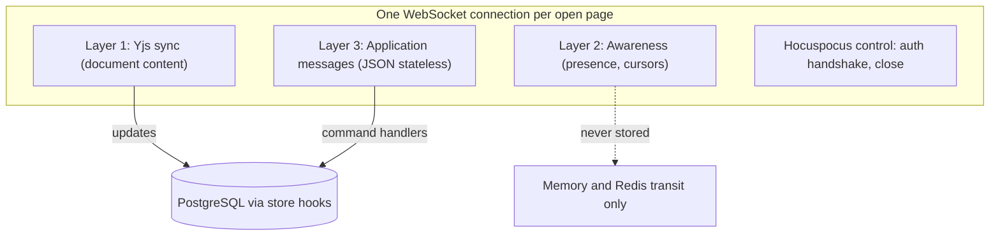
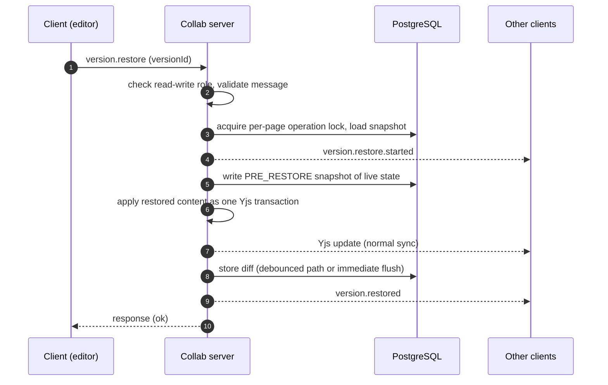

# CoNote – WebSocket Protocol

**Status:** Protocol design only. The Phase 1 collab process shell and health endpoints exist, but every document connection is deliberately rejected; no CoNote collaboration protocol feature is implemented. The disposable Phase 1b harness is prepared under `spikes/collab-poc/`, but S1–S11 have not yet been executed; all runtime-dependent statements below remain subject to the verification register.
**Last updated:** 2026-11-12

Decision IDs (`D#`, `U#`) are in [DECISIONS.md](DECISIONS.md); guarantees `G1`–`G7` and verification items `V#` are in [ARCHITECTURE.md](ARCHITECTURE.md) (§8, §18). REST contracts are in [API_CONTRACTS.md](API_CONTRACTS.md).

Items marked **(to verify)** depend on Hocuspocus 4.8 behaviour that has not been tested in the CoNote Phase 1b spike; the spike or named later phase must confirm them before they are relied on.

## 1. Overview and message layers

CoNote uses **Hocuspocus 4.x** as the collaboration server and `HocuspocusProvider` as the client (D1). The wire format of Hocuspocus and Yjs is owned by those libraries; **CoNote does not implement or modify it**. CoNote defines only: the connection and authentication contract, the permission behaviour, and a small JSON message set for application events.

Three layers share one WebSocket connection and must never be mixed:

| Layer | Carries | Owner | Persisted? |
|---|---|---|---|
| **1. Yjs sync** | Document updates (sync step 1/2 and incremental updates) | Yjs / y-protocols via Hocuspocus | Yes, by the server persistence hooks (D15) |
| **2. Awareness** | Ephemeral presence: user identity, cursor, selection | Yjs awareness via Hocuspocus | Never |
| **3. Application messages** | Document-scoped events and commands (JSON over Hocuspocus *stateless* messages, D32) | CoNote | Not as messages; effects are persisted by their handlers |

Hocuspocus also has its own connection-control messages (authentication handshake, close events). These are part of the library, not of CoNote's application layer.



## 2. Endpoints and names

| Item | Value |
|---|---|
| WebSocket URL | `wss://collab.<domain>/` (production); `ws://localhost:4100/` and `:4101` (local, two instances) |
| Document name | `page:<pageId>` where `<pageId>` is the page UUID. Validated against `^page:[0-9a-f]{8}-[0-9a-f]{4}-[0-9a-f]{4}-[0-9a-f]{4}-[0-9a-f]{12}$`; anything else is rejected as a protocol violation. |
| Documents per connection | One open page = one document provider. Whether providers share a socket is a client implementation detail. |
| Cookies | **Not used.** The collab origin is separate from the web origin (D6); authentication is by collaboration JWT only. |

## 3. Connection establishment

1. The client obtains a collaboration token: `POST /api/v1/pages/:pageId/collab-token` (`PAGE-10`; requires session and `PAGE≥VIEWER`).
2. The client opens the WebSocket to the collab URL returned in the response, using `HocuspocusProvider` with the document name and the token (a static value or a function returning a fresh token; function support **to verify – V6**).
3. **Transport:** TLS (`wss`) is required in production. The load balancer terminates TLS and supports WebSocket upgrades; sticky sessions are **not required** (D2).
4. **Origin check:** the collab server validates the `Origin` header of the upgrade request against the allow-list (D25) and rejects other origins before authentication.
5. **Authentication timeout:** a socket that does not complete authentication within a short, configurable timeout is closed (value set in Phase 6).
6. The token is carried in the provider's authentication message, **not in the URL** (to verify – V5), so it does not appear in access logs.

## 4. Authentication and authorization (D7, D22)

The collab server's authentication hook runs for every document the client opens.

**Token verification** (all must pass; any failure rejects the connection):

| Check | Rule |
|---|---|
| Signature | EdDSA (Ed25519) against the configured public key(s); key selected by `kid` |
| `iss` / `aud` | `conote-api` / `conote-collab` |
| `exp` / `iat` | Not expired; `iat` not in the future beyond a small clock-skew allowance |
| `pid` | Equals the page id in the requested document name |
| `jti` | Present (used for logging and optional replay detection; replay within the 60 s lifetime is accepted as low risk, see §14) |

**Authoritative checks against PostgreSQL** (the role in the token is never trusted):

1. The session `sid` exists, is not revoked and is within `expiresAt`/`absoluteExpiresAt`.
2. The page exists and is not soft-deleted.
3. The effective page role for the user is computed with the shared pure function (D23).

**Outcome:**

| Effective role | Result |
|---|---|
| `NONE` / no membership / page missing or deleted | Rejected (close reason `ACCESS_DENIED` or `PAGE_NOT_FOUND`) |
| `VIEWER`, `COMMENTER` | Connection accepted **read-only** |
| `EDITOR`, `ADMIN`, `OWNER` | Connection accepted **read-write** |

The server stores per connection: `{ userId, sessionId, pageId, role, readOnly, connectedAt }`. This context is used by every later check and never read from client messages.

## 5. Document subscription and synchronization

1. After authentication, the server loads the document if not already in memory on this instance: hydrate from `DocumentState` plus `DocumentUpdate` rows with `seq > foldedSeq` (ARCHITECTURE §8.4). If the document is open on another instance, loading waits for that instance's state up to `awaitInitialSyncTimeout` (default 1000 ms) (D2).
2. **Sync handshake (Yjs):** both sides exchange state vectors and the updates the other lacks. A reconnecting client therefore sends edits the server has not seen, and receives edits it missed.
3. After the handshake, incremental Yjs updates flow in both directions.
4. The server broadcasts each accepted update to the other connections of the document on this instance; the Redis extension forwards it to other instances (§10). This forwarding is best-effort Pub/Sub, not a replayable log.
5. **Persistence** is triggered by Hocuspocus's debounced store hook and by document unload, writing diffs to PostgreSQL (D15, G2). Clients receive no acknowledgment of durability; "saved" indicators in the UI mean *synced with the server*, not *committed to PostgreSQL*, and the UI must not claim more.

### Read-only enforcement

- The server **ignores** document updates from read-only connections: they are neither applied, broadcast nor persisted. Hocuspocus's read-only connection mode provides this (D1, Phase 1 spike confirms behaviour and whether the client is informed of dropped updates).
- The client also disables editing (defence in depth and UX), but server enforcement is the control (G6).
- Commenters need only read-only access: comments are REST (D8, FR-CM-06).

### Redis outage and resynchronization

Redis Pub/Sub does not retain or replay messages missed by a disconnected instance. Therefore:

1. During an outage, cross-instance live propagation is degraded; clients connected to different instances may temporarily diverge.
2. Redis becoming available again does not, by itself, repair documents already loaded in memory on both instances.
3. Phase 9 must implement a stale-document detection and recovery path. The baseline is to fence/mark affected documents, stop serving known-stale state, flush any state that can safely be committed, then force clients to reconnect to a document freshly hydrated from PostgreSQL. A surviving client can send its own uncommitted Yjs updates during the normal handshake. A server-to-server reconciliation alternative requires equivalent proof.
4. Until that mechanism is implemented and tested, the system must report degraded collaboration and must not claim automatic reconvergence.

## 6. Awareness and presence

### Awareness state

Each client publishes an awareness state through the Yjs awareness protocol:

```text
{
  user:   { id: <userId>, name: <displayName>, color: <presenceColor> },
  cursor: { anchor, head }      // written by the Tiptap CollaborationCaret / Yjs binding; may be absent
}
```

### Identity binding (anti-spoofing)

Awareness is client-supplied and therefore untrusted. Requirements:

1. `user.id` must equal the authenticated `userId` of the connection that sent it. The server rejects or drops awareness updates that claim a different id **(mechanism to verify – V14)**.
2. The presence UI resolves **display name, color and avatar from REST data (workspace members) by `user.id`**, and uses awareness only for `user.id`, cursor and selection. A forged `name` or `color` therefore cannot impersonate another user.
3. Awareness payloads have a size limit (§11).

### Presence semantics

| Feature | Derived from |
|---|---|
| Online collaborator list | Distinct `user.id` values across awareness states (multiple tabs of one user appear once) |
| Join notification | First awareness state for a `user.id` appears |
| Leave notification | Last awareness state for a `user.id` disappears, after a short grace period to avoid flicker on reconnect |
| Cursors, names beside cursors, selection highlights | `cursor` field plus identity lookup above |

Join/leave notifications are computed on the client from awareness changes; there are **no server application events for join/leave** (D32).

### Lifecycle and cleanup

- On a clean disconnect the server removes that connection's awareness states and broadcasts the removal.
- For crashed clients the awareness timeout of y-protocols removes stale states after its timeout (default values to verify – V3).
- If a collab **instance crashes**, awareness states of its clients that live in other instances' memory (received through Redis) may linger until the awareness timeout; this "ghost cursor" window is a known limitation to measure in the spike (V3).
- Awareness is never persisted. Viewers and commenters may or may not be able to publish awareness (to verify – U4); if not, they appear in the online list only after Phase 7 decides how.

## 7. Application messages (layer 3)

Application messages are JSON strings carried as Hocuspocus stateless messages, document-scoped (D32). Handler availability on the server for client-to-server messages is **to verify – V12**.

### Envelope

```json
{ "v": 1, "type": "version.restore", "id": "uuid", "replyTo": "uuid", "payload": { } }
```

| Field | Rule |
|---|---|
| `v` | Protocol version, integer, currently `1`. Unknown versions are rejected. |
| `type` | One of the registered types below. Unknown types are rejected. |
| `id` | Client-generated UUID on **requests**; used for correlation. |
| `replyTo` | Present on **responses**, equals the request `id`. |
| `payload` | Object validated by a Zod schema from `packages/shared`; unknown fields rejected. |

Maximum message size and per-connection message rate apply (§11).

### Client → server (commands)

| Type | Payload | Authorization | Effect |
|---|---|---|---|
| `version.create` | `{ "label"?: string (≤120) }` | Connection read-write (`PAGE≥EDITOR`) | Creates a `MANUAL` snapshot of the live document; logs `version.created`; broadcasts `version.created`; replies `response` |
| `version.restore` | `{ "versionId": uuid }` | Connection read-write (`PAGE≥EDITOR`) | Restore procedure (§8); replies `response` or `error` |

### Server → client

| Type | Audience | Payload | Meaning |
|---|---|---|---|
| `response` | Requester | `{ "ok": true, "result"?: object }` (with `replyTo`) | Command succeeded |
| `error` | Requester | `{ "code": string, "message": string }` (with `replyTo`) | Command failed. Codes: `INVALID_MESSAGE`, `FORBIDDEN`, `NOT_FOUND`, `CONFLICT` (another snapshot/restore is running), `RATE_LIMITED`, `INTERNAL_ERROR` |
| `version.created` | All connections of the document | `{ "versionId", "kind", "label", "createdBy": userId \| null }` | A snapshot was created (manual or automatic) |
| `version.restore.started` | All | `{ "restoredBy": userId }` | Restore beginning; clients put the editor in a temporary non-editable state |
| `version.restored` | All | `{ "versionId", "preRestoreVersionId", "restoredBy": userId }` | Restore applied; editing may resume |
| `version.restore.failed` | All | `{ "reason": string }` | Restore aborted; editors resume (document unchanged) |
| `comments.changed` | All | `{ "pageId" }` | Comments changed; clients refetch threads (`CMT-01`) |
| `access.changed` | The affected connection | `{ "readOnly": boolean, "role": string }` | The user's effective access changed (downgrade or upgrade) |
| `access.revoked` | The affected connection | `{ "reason": "SESSION_REVOKED" \| "MEMBER_REMOVED" \| "ACCESS_REMOVED" \| "PAGE_DELETED" \| "WORKSPACE_DELETED" }` | Sent immediately before the server closes the connection |
| `server.shutting_down` | All | `{ }` | Graceful shutdown starting; clients reconnect (possibly to another instance) |

`comments.changed` originates in the API (REST comment endpoints) and reaches clients through the Redis `page` channel (§10), so it works for connections on any instance. Delivery is at-most-once; clients also refetch comments on reconnect and on window focus.

## 8. Version restore procedure (D9)



Rules:

1. A per-page **durable restore barrier** serializes restore against document updates across all collab instances. PostgreSQL is the correctness authority; Redis events may notify instances but are not the lock.
2. The server marks the page as restoring in PostgreSQL and all update/store paths must respect that state/fencing token. New updates are rejected or held while the barrier is active. The server drains and commits updates accepted before the barrier, then creates the `PRE_RESTORE` snapshot from the quiescent live state.
3. Only after the PRE_RESTORE snapshot commits does the server apply the selected content as one new Yjs transaction and persist that transaction. It then releases the barrier and forces/reconciles clients through normal Yjs sync. Existing snapshots are untouched (G7).
4. If the barrier cannot be established, prior updates cannot be drained, the PRE_RESTORE snapshot fails, or the restore transaction fails, the restore is aborted without partially changing the live document; the restoring marker/lock is safely cleared. A concurrent request receives `CONFLICT`.
5. The Phase 8 implementation must prove this across two collab instances, including clients editing during the restore. A client-side banner is advisory only; it is not a correctness mechanism.
5. After the restore the server resolves comment anchors against the new document and marks unresolvable threads `DETACHED` (U8).
6. Activity: `version.restored` is logged with the version ids.

## 9. Disconnect handling and reconnection

### Server side

| Event | Behaviour |
|---|---|
| Client closes or drops | Remove the connection's awareness states and broadcast; if it was the last connection, store the document and unload it (to verify – V1) |
| Instance receives SIGTERM | Stop accepting connections, send `server.shutting_down`, flush stores for all loaded documents, close connections with a "restarting" close code, then exit |
| Instance crash | Connections drop; clients reconnect elsewhere; uncommitted updates survive only in clients (G3) |

### Client side

1. `HocuspocusProvider` reconnects automatically with backoff (parameters to confirm in Phase 6).
2. **Every reconnection fetches a fresh token** (`PAGE-10`). If the API returns `401` the UI prompts for login; if it returns `404`/`403` the page is shown as unavailable.
3. While disconnected the editor shows a "reconnecting/offline" banner. Local edits remain in the client's `Y.Doc` and are sent in the sync handshake after reconnecting. **There is no offline persistence in the MVP**, so closing the tab while changes are unsynced loses them. The client warns on tab close/navigation when the provider reports unsynced changes (property to confirm in Phase 6).
4. A reconnecting client may land on a different instance; this is expected (D2).
5. After reconnecting, clients refetch comments and the version list (missed `comments.changed`/`version.created` messages).

### Close reasons

CoNote's logical close reasons, with a proposed WebSocket close code where the library allows custom codes (mapping to Hocuspocus's own close events is to verify – V13):

| Logical reason | Proposed code | Client behaviour |
|---|---|---|
| Normal close | 1000 | None |
| Server restarting/shutting down | 1012 | Reconnect with backoff |
| Message too large | 1009 | Do not retry the same message; report error |
| `AUTH_FAILED` (bad/expired token) | 4401 | Fetch a new token and retry; stop after repeated failures |
| `ACCESS_DENIED` | 4403 | Show "no access"; do not retry |
| `PAGE_NOT_FOUND` (missing/deleted) | 4404 | Show "page unavailable"; do not retry |
| `ACCESS_REVOKED` (after `access.revoked`) | 4410 | Show the reason; do not auto-retry |
| `PROTOCOL_VIOLATION` | 4400 | Report error; do not retry |
| `RATE_LIMITED` / too many connections | 4429 | Retry after a longer delay |

## 10. Permission enforcement over time and cross-instance behaviour

### Redis channels

| Channel | Publisher | Subscribers | Payload (JSON, `v: 1`) | Purpose |
|---|---|---|---|---|
| Hocuspocus extension channels (under a dedicated prefix; option name to verify) | Collab instances | Collab instances | Library-defined | Yjs updates, awareness, document sync between instances (D2) |
| `conote:events:access` | API | All collab instances | `{ v, type, userId?, sessionId?, workspaceId?, pageId?, at }` with `type` ∈ `session.revoked`, `member.role_changed`, `member.removed`, `workspace.deleted`, `page.access_changed` | Trigger access recomputation (D22) |
| `conote:events:page` | API | All collab instances | `{ v, type: "comments.changed", pageId, at }` | Each instance forwards `comments.changed` to its connections for that page |

These application channels are separate from the Hocuspocus extension channels. Redis pub/sub is **at-most-once**: a message is lost if an instance is not subscribed at that moment.

### Handling an access event

1. Each instance finds its open connections matching the event (by `userId`, `sessionId`, `pageId` or `workspaceId`); for events that can affect descendants (move, permission changes), all connections that could be affected, falling back to full revalidation.
2. For each, it re-reads the session and recomputes the effective role from PostgreSQL.
3. Result: no change → nothing; **downgrade** to read-only → set the connection read-only and send `access.changed`; **upgrade** → set read-write and send `access.changed`; **no access** → send `access.revoked` and close with `ACCESS_REVOKED`.

### Periodic revalidation (safety net)

Every revalidation interval (initial 60 s, `COLLAB_REVALIDATE_INTERVAL_MS`, D22) each instance re-checks every open connection (session validity, page existence, effective role) with the same procedure. This bounds exposure when an event is lost (G6). The bound is a target verified by permission tests, not a proven figure.

### Cross-instance document synchronization

- Updates and awareness received on one instance are forwarded through Redis to the others; every instance handles every message (D2).
- Each instance persists via the row-locked diff procedure (ARCHITECTURE §8.2), so concurrent stores from several instances stay correct; redundant rows are harmless.
- **Redis outage:** instances may continue serving their already-connected clients and PostgreSQL persistence remains independent; cross-instance propagation pauses. Redis Pub/Sub does not replay messages missed during the outage. Redis reconnection alone does **not** guarantee that already-open documents reconverge. The spike must observe divergence and evaluate a candidate explicit resync/reconnect procedure; production recovery is selected and verified in Phase 9 (U13/G5).
- No clients are routed by document; any client may connect to any instance.

## 11. Error handling, limits and abuse protection

| Condition | Server behaviour |
|---|---|
| Invalid/expired token, bad signature, wrong audience/page | Reject; close `AUTH_FAILED` |
| Authenticated but no access | Reject; close `ACCESS_DENIED` or `PAGE_NOT_FOUND` |
| Invalid document name | Close `PROTOCOL_VIOLATION` |
| Malformed Yjs update (apply throws) | Drop the message, log with `requestId`/connection id, close the connection on repeat |
| Update from read-only connection | Ignored; not applied, persisted or broadcast; counted and logged |
| Application message: invalid JSON/schema, unknown `type`/`v` | `error INVALID_MESSAGE`; repeated violations close the connection |
| Command without sufficient role | `error FORBIDDEN` |
| Oversized message | Reject; close 1009 (mechanism to verify – V11) |
| Message or awareness flood | Per-connection rate limiting; `RATE_LIMITED`; close 4429 on persistent abuse |
| Too many connections per user or instance | Close 4429 at connect |
| PostgreSQL unavailable on load | Close with a "try again later" reason; clients retry with backoff |
| PostgreSQL unavailable on store | Keep the document in memory, retry stores, log and alert; durability is not claimed until a commit succeeds (G2) |
| Unexpected handler exception | `error INTERNAL_ERROR` (no internal details); connection stays open unless the document state is suspect |

**Limits** (configured in Phase 6 and tuned in Phase 9 from measurements; no values are assumed in Phase 0): maximum message/update size, awareness payload size, message rate per connection, connections per user, connections per instance, concurrent documents per instance.

## 12. Security checklist for the WebSocket layer

- [ ] TLS only in production; `Origin` allow-list on upgrade (D25).
- [ ] Short-lived EdDSA token; verification with `aud`, `iss`, `exp`, `pid`; no token in URL (V5).
- [ ] Authorization from PostgreSQL on connect, event-driven downgrade/close, periodic revalidation (G6).
- [ ] Read-only enforced on the server, not only in the UI.
- [ ] Awareness identity binding; UI trusts REST data for names/colors (V14).
- [ ] All application messages Zod-validated; unknown types rejected; command rate limits.
- [ ] Size, rate and connection limits configured.
- [ ] No document content, tokens or secrets in logs.

## 13. Configuration summary (names provisional; finalized in Phase 6)

| Setting | Meaning | Initial default |
|---|---|---|
| `COLLAB_PORT` | Listen port | 4100 (4101 for the second local instance) |
| `COLLAB_JWT_PUBLIC_KEYS` | Public key(s) with `kid` for token verification | n/a |
| `COLLAB_ALLOWED_ORIGINS` | Allowed `Origin` values | web origin |
| `COLLAB_REVALIDATE_INTERVAL_MS` | Periodic revalidation interval | 60000 |
| `COLLAB_STORE_DEBOUNCE_MS` / `COLLAB_STORE_MAX_DEBOUNCE_MS` | Store debounce settings (D15) | 2000 / 10000 (to be confirmed against Hocuspocus options) |
| `COLLAB_COMPACT_UPDATE_COUNT` | Compaction threshold | 200 |
| `COLLAB_AWAIT_INITIAL_SYNC_MS` | Redis extension `awaitInitialSyncTimeout` | 1000 (library default) |
| `REDIS_URL`, `DATABASE_URL` | Backing services | n/a |

The full environment variable table is in DEPLOYMENT.md.

## 14. Known limitations and accepted risks

1. **No durability acknowledgment to clients** (G2, G3). The UI shows sync state only.
2. **No offline persistence** in the MVP; unsynced edits are lost if the tab closes.
3. **Token replay within 60 s** is not prevented; the token is short-lived, audience- and page-bound, and the server re-checks the session and role from the database. Replay detection by `jti` may be added if the spike or security review (Phase 10) warrants it.
4. **Revocation latency** is bounded by event delivery or the revalidation interval, not instantaneous (G6).
5. **Ghost presence** after instance crashes until awareness timeout (V3).
6. **Concurrent edits during a restore** are serialized by the durable restore barrier (§8); a client banner alone is not sufficient.
7. **Redis outage** splits cross-instance live sync until reconnection (G5).

## 15. Verification items owned by this document

The Phase 1b harness is prepared but not yet executed. The items below are checked by the Phase 1 spike unless another phase is named: V1 (store/unload semantics), V2 (store hook for Redis-originated updates), V3 (awareness propagation and expiry), V4 (reconvergence after Redis outage), V5 (token not in URL), V6 (token function on reconnect, Phase 6), V11 (size and connection limits, Phase 6/9), V12 (client-to-server stateless messages), V13 (close codes), V14 (awareness identity enforcement). See ARCHITECTURE.md §18 and IMPLEMENTATION_PLAN.md Phase 1.

## 16. References

- Hocuspocus hooks – https://tiptap.dev/docs/hocuspocus/server/hooks
- Hocuspocus authentication – https://tiptap.dev/docs/hocuspocus/guides/authentication
- Hocuspocus Redis extension – https://tiptap.dev/docs/hocuspocus/server/extensions/redis
- Hocuspocus collaborative editing – https://tiptap.dev/docs/hocuspocus/guides/collaborative-editing
- Tiptap Collaboration extension – https://tiptap.dev/docs/editor/api/extensions/collaboration
- Yjs documentation (sync, awareness, relative positions) – https://docs.yjs.dev *(not fetched during Phase 0)*
- RFC 6455 (WebSocket protocol, close codes) – https://www.rfc-editor.org/rfc/rfc6455 *(not fetched during Phase 0)*
